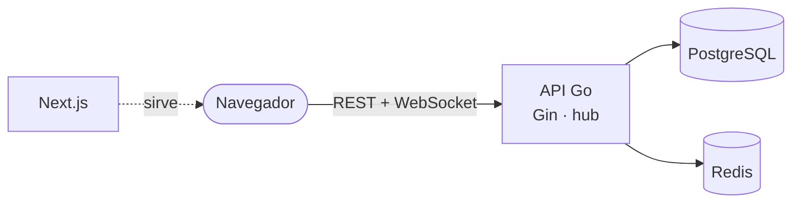

[English](README.md) · **🌐 Español**

# WebChat

Plataforma de chat en tiempo real: salas públicas y privadas, mensajes directos, respuestas, reacciones, mensajes fijados, búsqueda de texto completo, herramientas de moderación y una interfaz clara/oscura en inglés y español.

## Lo esencial

- **Mensajería en vivo** por WebSockets con autenticación mediante ticket de un solo uso, validación del origen, presencia e indicador de "escribiendo".
- **Encontrar y llegar a la gente:** un panel de personas siempre visible con su estado de conexión, mensajes directos a cualquiera, salas descubribles (las privadas se listan pero requieren invitación) e invitaciones personales que se aceptan o rechazan.
- **Sesiones seguras:** access JWT de 1 hora guardado solo en memoria, más un refresh token rotativo de un solo uso en cookie httpOnly.
- **Roles y moderación:** una única matriz de permisos por rangos, denuncias, vetos temporales o permanentes y registro de auditoría.
- **Pensado para escalar:** varias instancias del backend pueden atender la misma sala mediante Redis pub/sub.
- **Privacidad:** exporta tus datos y elimina tu cuenta.



## Documentación

| | |
|---|---|
| [Primeros pasos](docs/es/getting-started.md) | Ejecútalo en local en pocos minutos |
| [Arquitectura](docs/es/architecture.md) | Módulos, capas, ciclo de una petición, diagramas |
| [Decisiones de diseño](docs/es/decisions.md) | **Por qué** se eligió cada tecnología y patrón |
| [Seguridad](docs/es/security.md) | Autenticación, permisos, límites, auditoría |
| [Tiempo real](docs/es/realtime.md) | Hub WebSocket, presencia, escalado |
| [Modelo de datos](docs/es/data-model.md) | Diagrama entidad-relación y convenciones |
| [Referencia de la API](docs/es/api.md) | Todos los endpoints; referencia interactiva con [Scalar](https://scalar.com) en `/docs` con el backend en marcha |
| [Frontend](docs/es/frontend.md) | Estructura, sesión, i18n, temas |
| [CI/CD](docs/es/ci-cd.md) | Pipeline, imágenes de contenedor y el camino a AWS |
| [Contribuir](docs/es/contributing.md) | Flujo, reglas y controles de calidad |

Cada página tiene un selector de idioma en su primera línea. Los documentos de trabajo del equipo (roadmap, casos de uso, hallazgos) están en español en [`docs/`](docs/).

## Tecnologías

| | |
|---|---|
| Backend | Go 1.26, Gin, PostgreSQL 16, Redis, Gorilla WebSocket, JWT |
| Frontend | Next.js 16 (App Router), React 19, TypeScript, Tailwind CSS, React Hook Form + Zod, Axios |
| Herramientas | Docker Compose, Make, `air`, CI con GitHub Actions |

## Inicio rápido

```bash
cd backend && docker compose up -d db redis
cp .env.example .env.local        # rellena los valores y luego:
make watch                        # http://localhost:8081
cd ../frontend && cp .env.example .env.local
pnpm install && pnpm dev            # http://localhost:3100
```

Cuando existan los dos `.env.local`, `make setup` y luego `make dev` desde la raíz del repositorio hacen todo esto de una vez (`make help` lista todos los objetivos).

| Servicio | Puerto (localhost) |
|---|---|
| Frontend | 3100 |
| Backend | 8081 |
| PostgreSQL | 5433 |
| Redis | 6380 |

## Estructura del repositorio

```
backend/    API en Go (Clean Architecture, un paquete por módulo)
frontend/   Aplicación Next.js
docs/       documentación en en/ y es/, más documentos de trabajo en español
```

## Licencia

Ver [LICENSE](LICENSE).
