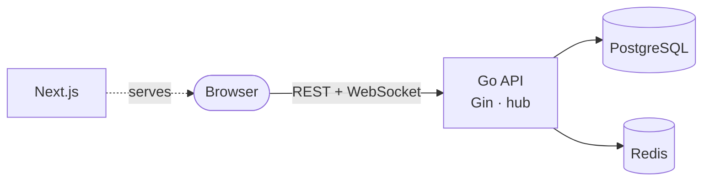

**🌐 English** · [Español](README.es.md)

# WebChat

Real-time chat platform: public and private rooms, direct messages, replies, reactions, pinned messages, full-text search, moderation tools and a light/dark, English/Spanish interface.

## Highlights

- **Live messaging** over WebSockets with single-use ticket authentication, origin checks, presence and typing indicators.
- **Find and reach people:** an always-visible people panel with live online status, direct messages to anyone, discoverable rooms (private ones are listed but need an invitation) and personal invitations you accept or decline.
- **Secure sessions:** 1-hour access JWT held only in memory, plus a single-use rotating refresh token in an httpOnly cookie.
- **Roles and moderation:** one rank-based permission matrix, reports, temporary or permanent bans and an audit log.
- **Built to scale out:** several backend instances can serve the same room through Redis pub/sub.
- **Privacy:** export your data and delete your account.



## Documentation

| | |
|---|---|
| [Getting started](docs/en/getting-started.md) | Run it locally in a few minutes |
| [Architecture](docs/en/architecture.md) | Modules, layers, request lifecycle, diagrams |
| [Design decisions](docs/en/decisions.md) | **Why** each technology and pattern was chosen |
| [Security](docs/en/security.md) | Authentication, permissions, rate limits, audit |
| [Real-time](docs/en/realtime.md) | WebSocket hub, presence, scaling out |
| [Data model](docs/en/data-model.md) | Entity-relationship diagram and conventions |
| [API reference](docs/en/api.md) | Every endpoint; interactive [Scalar](https://scalar.com) reference at `/docs` when the backend runs |
| [Frontend](docs/en/frontend.md) | Structure, session, i18n, theming |
| [CI/CD](docs/en/ci-cd.md) | Pipeline, container images and the road to AWS |
| [Contributing](docs/en/contributing.md) | Workflow, rules and quality gates |

Every page has a language switch on its first line. Team working documents (roadmap, use cases, findings tracker) are in Spanish under [`docs/`](docs/).

## Tech stack

| | |
|---|---|
| Backend | Go 1.27, Gin, PostgreSQL 16, Redis, Gorilla WebSocket, JWT |
| Frontend | Next.js 16 (App Router), React 19, TypeScript, Tailwind CSS, React Hook Form + Zod, Axios |
| Tooling | Docker Compose, Make, `air`, GitHub Actions CI |

## Quick start

```bash
cd backend && docker compose up -d db redis
cp .env.example .env.local        # fill in the values, then:
make watch                        # http://localhost:8081
cd ../frontend && cp .env.example .env.local
pnpm install && pnpm dev            # http://localhost:3100
```

Once both `.env.local` files exist, `make setup` and then `make dev` from the repository root do all of this in one step (`make help` lists every target).

| Service | Port (localhost) |
|---|---|
| Frontend | 3100 |
| Backend | 8081 |
| PostgreSQL | 5433 |
| Redis | 6380 |

## Repository layout

```
backend/    Go API (Clean Architecture, one package per module)
frontend/   Next.js app
docs/       en/ and es/ documentation, plus Spanish working documents
```

## License

See [LICENSE](LICENSE).
