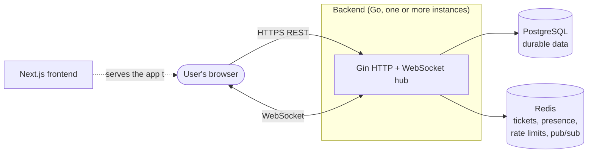

**🌐 English** · [Español](../es/README.md)

# WebChat documentation

WebChat is a real-time chat platform: rooms, direct messages, reactions, pinned messages, search and a moderation toolkit. This documentation explains **how it works** and, above all, **why it was built this way**.

## Reading guide

| If you want to… | Read |
|---|---|
| Run it on your machine | [Getting started](getting-started.md) |
| Understand the big picture | [Architecture](architecture.md) |
| Know why a technology or pattern was chosen | [Design decisions](decisions.md) |
| Understand login, tokens, permissions and abuse protection | [Security](security.md) |
| Understand live messaging, presence and scaling out | [Real-time](realtime.md) |
| See the tables and their relationships | [Data model](data-model.md) |
| Call the API | [API reference](api.md) |
| Work on the UI | [Frontend](frontend.md) |
| Send a change | [Contributing](contributing.md) |

## Map of the system

## Project documents (Spanish)

These are the team's working documents and are kept in Spanish: [Roadmap](../ROADMAP.md), [Use cases](../CASOS_DE_USO.md), [Findings tracker](../HALLAZGOS.md) and the original [setup guide](../LEVANTAR.md) with troubleshooting.
