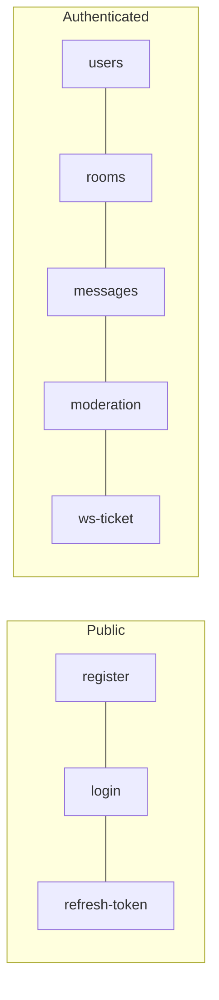

**🌐 English** · [Español](../es/api.md)

# API reference

> **Interactive reference:** run the backend and open **[http://localhost:8081/docs](http://localhost:8081/docs)** ([Scalar](https://scalar.com)). It renders the OpenAPI 3.1 contract, lets you try every endpoint and generates code samples. The raw contract is served at `/openapi.yaml` and lives in [`backend/api/openapi.yaml`](../../backend/api/openapi.yaml). The tables below are a quick overview; the contract is the detailed source of truth.

Base URL in development: `http://localhost:8081/api/v1` (health checks live outside the prefix). JSON in, JSON out.

**Authentication:** every endpoint except those marked *public* needs `Authorization: Bearer <access token>`.

**Errors:** a non-2xx response carries `{ "error": "message" }`. Common statuses: `400` invalid input, `401` missing or expired token, `403` not allowed, `404` not found, `409` conflict, `429` rate limited (with `Retry-After`).



## Health

| Method | Path | Description |
|---|---|---|
| GET | `/health` | Liveness. Always `200 {"status":"ok"}` *(public)* |
| GET | `/ready` | Readiness. Pings the database and Redis; `503` if one is down *(public)* |

## Auth `/auth`

| Method | Path | Description |
|---|---|---|
| POST | `/auth/register` | Create an account: `name`, `last_name`, `username` (3–30), `email`, `phone`, `password` (8–72) *(public)* |
| POST | `/auth/login` | `{ user, password }` returns `{ user, token }` (the access token) and sets the `refresh_token` cookie *(public)* |
| POST | `/auth/refresh-token` | Rotates the refresh cookie and returns a new access token *(public, needs the cookie)* |
| POST | `/auth/logout` | Revokes the refresh token and clears the cookie |
| POST | `/auth/send-verify-email/:user_id` | Sends a verification email *(public; verification is paused)* |
| POST | `/auth/verify-email/:token` | Confirms an email *(public; paused)* |

## Users `/users`

| Method | Path | Description |
|---|---|---|
| GET | `/users/profile` | Current user's profile, including the global `role` |
| GET | `/users/directory?q=` | People directory with online status, online first |
| DELETE | `/users/deactivate` | Disable the account and sign out |
| GET | `/users/export` | Download all of the user's data as JSON |
| DELETE | `/users/me` | Delete the account permanently; body carries the password |

## Rooms `/rooms`

| Method | Path | Description |
|---|---|---|
| POST | `/rooms` | Create a room: `name`, `topic`, `is_private`. The creator becomes owner |
| GET | `/rooms` | The user's rooms, with `unread_count`, `is_direct` and `my_role` |
| GET | `/rooms/discover` | Every non-direct room; private ones are listed but need an invitation |
| POST | `/rooms/invite-user/:room_id` | Invite a specific user (admin or above) |
| GET | `/rooms/invitations` | My pending invitations |
| POST | `/rooms/invitations/:id/accept` · `/decline` | Answer an invitation; accepting makes me a member |
| POST | `/rooms/join/:room_id` | Join a public room (fails if banned) |
| POST | `/rooms/direct/:user_id` | Open (or reuse) the one-to-one room with that user |
| GET | `/rooms/members/:room_id` | Members with role and online status |
| POST | `/rooms/leave/:room_id` | Leave a room (the owner cannot) |
| POST | `/rooms/read/:room_id` | Mark the room as read |
| POST | `/rooms/invite/:room_id` | Create an invitation (admin or above) |
| POST | `/rooms/accept-invite/:code` | Join through an invitation code |

## Messages `/messages`

| Method | Path | Description |
|---|---|---|
| GET | `/messages/:roomId/messages?limit=&before=` | History, newest first, cursor-paginated |
| GET | `/messages/:roomId/pinned` | Pinned messages of a room |
| GET | `/messages/search?q=&room_id=` | Full-text, accent-insensitive search across the user's rooms (or one room) |
| POST | `/messages` | Send: `room_id`, `content`, optional `reply_to_message_id` |
| PATCH | `/messages/:id` | Edit (author only) |
| DELETE | `/messages/:id` | Delete (author, or a moderator or above) |
| PUT / DELETE | `/messages/:id/pin` | Pin / unpin (admin or above) |
| POST / DELETE | `/messages/:id/reactions` | Add / remove an emoji reaction |

## Moderation `/moderation`

| Method | Path | Minimum rank |
|---|---|---|
| POST | `/moderation/messages/:message_id/report` | member (not your own message, once per person) |
| POST | `/moderation/reports/:report_id/resolve` | moderator (`{ action: "resolve" \| "ignore", delete_message }`) |
| GET | `/moderation/rooms/:room_id/reports` | moderator |
| GET | `/moderation/rooms/:room_id/bans` | moderator |
| POST | `/moderation/rooms/:room_id/bans/:user_id` | moderator, strictly above the target; body `{ reason, duration }` where `duration` is a Go duration such as `24h` (empty = permanent) |
| DELETE | `/moderation/rooms/:room_id/bans/:user_id` | moderator |
| PATCH | `/moderation/rooms/:room_id/members/:user_id/role` | admin (see [Security](security.md)) |
| DELETE | `/moderation/rooms/:room_id/members/:user_id` | moderator, strictly above the target |
| GET | `/moderation/rooms/:room_id/audit` | admin |

## WebSocket

| Method | Path | Description |
|---|---|---|
| POST | `/ws-ticket` | Returns a 30-second, single-use ticket |
| GET | `/ws?ticket=…` | Upgrades to a WebSocket; the `Origin` must be allowed |

Event types and payloads are described in [Real-time](realtime.md).

## Example

```bash
# log in and keep the refresh cookie
curl -s -i -c jar.txt -X POST http://localhost:8081/api/v1/auth/login \
  -H 'Content-Type: application/json' \
  -d '{"user":"you@example.com","password":"a-long-password"}'

# call an endpoint with the access token from the response body
curl -s http://localhost:8081/api/v1/rooms -H "Authorization: Bearer $TOKEN"

# renew the access token with the cookie
curl -s -b jar.txt -X POST http://localhost:8081/api/v1/auth/refresh-token
```

## Keeping the contract honest

`backend/api/openapi.yaml` is written by hand and embedded in the binary (`go:embed`), so a running server always documents itself. **Any change to a route, a request body or a response must update the YAML in the same commit.** `go test ./api/` checks that the document is valid YAML, that every `$ref` resolves, that each operation has a unique `operationId`, a summary, a tag and responses, and that the set of public (no-auth) operations only changes on purpose.

The page loads Scalar from a pinned version on the jsDelivr CDN, so viewing `/docs` needs internet access; `/openapi.yaml` works offline and can be imported into Postman, Insomnia or a code generator.
