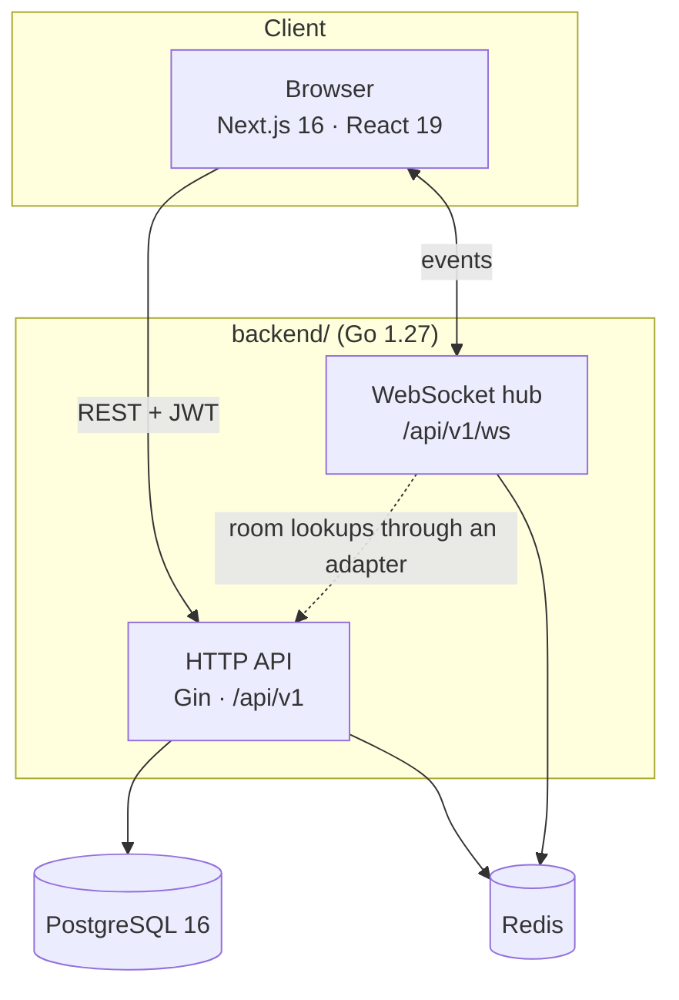
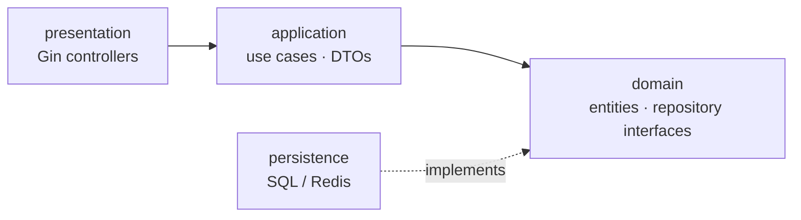
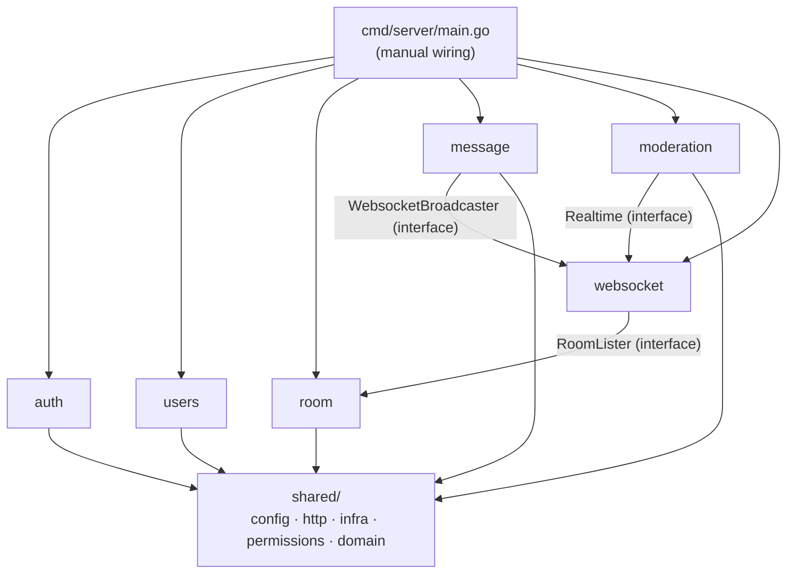
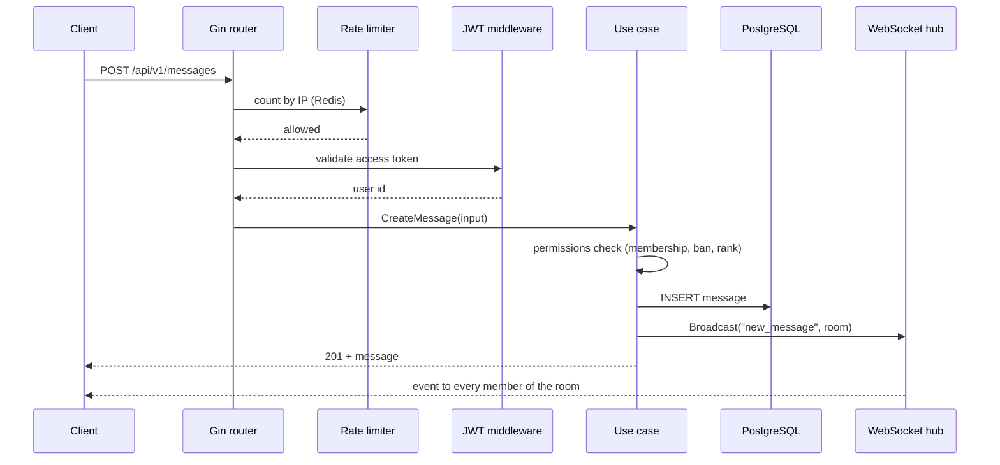
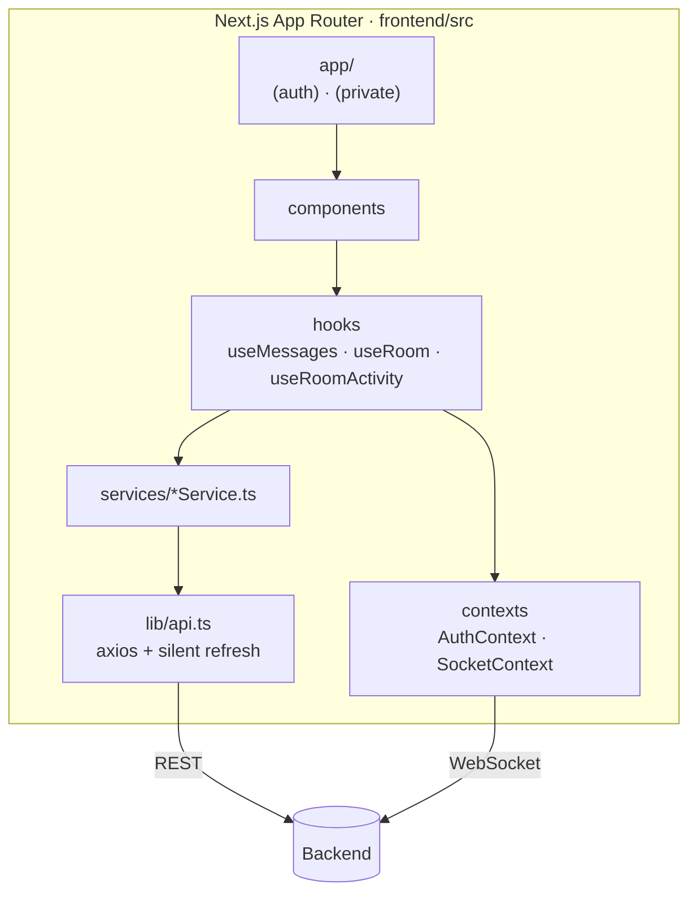
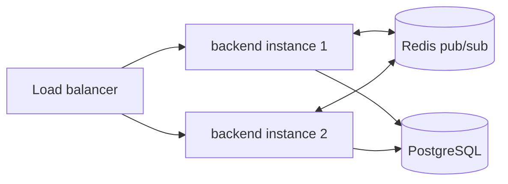

**🌐 English** · [Español](../es/architecture.md)

# Architecture

## 1. System context

WebChat is a **modular monolith** with two independently deployable apps in one repository.

| Piece | Responsibility | Port (host) |
|---|---|---|
| Frontend | UI, session state, live updates | 3100 |
| Backend | REST API, WebSocket hub, migrations on startup | 8081 |
| PostgreSQL | Durable data: users, rooms, messages, audit | 5433 |
| Redis | Short-lived state: refresh-token ids, WS tickets, presence, rate counters, cross-instance event bus | 6380 |

## 2. Backend: Clean Architecture, one package per module

Each business module under `backend/internal/` has the same four layers. Dependencies point **inwards only**: presentation → application → domain, and persistence implements interfaces that the domain declares.

Modules: `auth`, `users`, `room`, `message`, `moderation`, plus `websocket` and `shared`.

`shared/` holds cross-cutting code: `config`, `http` (server, JWT middleware, rate limiter, health), `infra` (database, Redis, JWT and mail services), `permissions` (the authorization matrix) and `domain` (shared errors, transaction types).

### Wiring

`cmd/server/main.go` builds the config, database pool, Redis client, services and repositories, then calls each module's `RegisterModule(...)`, which constructs the module's use cases and controller and registers its routes. Adding a dependency means threading it through `main.go` and the module's `RegisterModule` signature.

### Transactions

Use cases that must change several tables atomically run through `Store` (`shared/infra/db/sql_store.go`), which wraps a function in a database transaction. Controllers never touch the database.

## 3. Request lifecycle

## 4. Frontend

See [Frontend](frontend.md) for details.

## 5. Deployment topology

Any number of backend instances can serve the same room because events travel through Redis. See [Real-time](realtime.md). Deployment automation (images, environments, backups) is outside the scope of this documentation.

## 6. Configuration

`config.NewConfig` reads environment variables, optionally pre-loading the file named by `CONFIG_FILE`. `DATABASE_URL` (or `DB_USER`/`DB_HOST`/`DB_PORT`/`DB_NAME`) is required, and `REDIS_URL` can likewise be assembled from `REDIS_*` parts. The server refuses to start without `JWT_SECRET`. The committed templates are `backend/.env.example` and `frontend/.env.example`; real env files are git-ignored.
