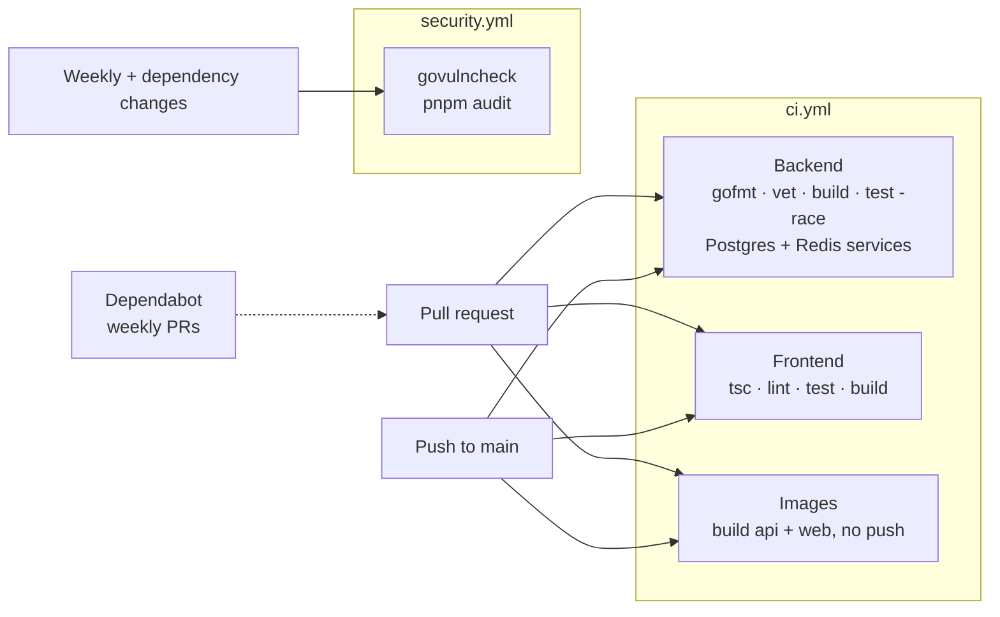

**🌐 English** · [Español](../es/ci-cd.md)

# CI/CD and container images

How a change is verified before it reaches `main`, and how the container images are built. Nothing here is tied to one cloud, and nothing is published: CI only proves the images build.

## 1. The pipeline



| Workflow | Runs on | What it guarantees |
|---|---|---|
| `ci.yml` · backend | every push and pull request | formatting, `go vet`, compilation, all tests with the race detector, that **every migration applies to an empty PostgreSQL** and the Redis presence tests (both skipped locally unless `TEST_DATABASE_URL` / `TEST_REDIS_ADDR` are set) |
| `ci.yml` · frontend | same | type check, lint, tests, production build |
| `ci.yml` · images | every push and pull request | both Dockerfiles build (nothing is published) |
| `security.yml` | weekly, and when dependency files change | no reachable Go vulnerability (`govulncheck`) and no high-severity JavaScript advisory (`pnpm audit`) |
| Dependabot | weekly, grouped, 7-day cooldown | pull requests for Go, JavaScript, Dockerfile base images, `docker-compose.yml` and the workflow actions (one grouped PR per ecosystem for minor/patch) |

## 2. The images

| Image | Base | Size | Notes |
|---|---|---|---|
| `webchat-api` | `distroless/static`, non-root | ≈ 40 MB | static Go binary; no shell, no package manager |
| `webchat-web` | `node:24-alpine`, non-root | ≈ 315 MB | Next.js `standalone` output; listens on 3100 |

The frontend lockfile (`frontend/pnpm-lock.yaml`) is committed: CI and the image install exactly the versions you tested (`--frozen-lockfile`).

Build them yourself:

```bash
docker build -t webchat-api backend
docker build -t webchat-web --build-arg NEXT_PUBLIC_API_URL=https://api.example.com/api/v1 frontend
```

## 3. Decisions behind it

See **D19** in [Design decisions](decisions.md). In short:

- **Images are the runnable unit.** Any platform (ECS, EKS, a VM with Docker, Kubernetes) can run an image; scripts tied to one provider cannot move.
- **CI builds, it does not publish.** Building on every run catches a broken Dockerfile before merge; where and how images are stored and deployed is left to whoever deploys.
- **One web image per environment.** Next.js inlines `NEXT_PUBLIC_*` values into the browser bundle at build time, so the API URL is a build argument (set the repository variable `NEXT_PUBLIC_API_URL`). The alternative, reading the URL at runtime, would need a config endpoint or a startup script; it is simple to add if more environments appear.
- **Security checks are separate and non-blocking for unrelated PRs.** A new advisory in a dependency appears without anyone touching the code; it should raise a visible alarm, not stop an unrelated fix.

### Pinning and upgrades (D28)

- Actions are pinned to a full commit SHA with the release in a comment; Dependabot updates both.
- Dockerfile bases (`golang`, `distroless/static-debian13`) are pinned by tag **and digest**; Dependabot refreshes the digest. The Postgres (16) and Redis (8) images in compose, CI and `make test-integration` are major-tag only and Dependabot never proposes their majors (a major is a data migration).
- Moving to a new Go minor is manual and touches four places together: the `go` directive in `backend/go.mod` (patch level included), the `golang` tag and digest in `backend/Dockerfile`, the version in the docs, and a read of the release notes. `govulncheck` in `security.yml` is pinned by hand (Dependabot cannot see it).

## 4. Getting ready for AWS

This section records what the application already provides and what is still a decision, so nobody assumes a feature exists that does not. Nothing below is implemented in the repository.

**Already true**

| Property | Why it matters in the cloud |
|---|---|
| Stateless backend, state in PostgreSQL and Redis | run several copies behind a load balancer; scale and replace freely |
| Configuration only through environment variables | maps to task definitions, parameter stores and secret managers without code changes |
| `GET /health` and `GET /ready` | ready-made targets for load-balancer and orchestrator health checks |
| WebSocket events relayed through Redis | any instance can serve any room, so no sticky sessions are needed |
| Heartbeat every ~54 s | stays under the 60 s default idle timeout of an AWS load balancer, so connections are not cut |
| Migrations run at startup under a database lock | several instances can start together without corrupting the schema |
| Non-root, minimal images | smaller attack surface |

**Decisions for later**

| Topic | Notes |
|---|---|
| Registry and publishing | not set up; if added later, authenticate the workflow with an **OIDC role** (`aws-actions/configure-aws-credentials`) rather than stored access keys |
| Where it runs | ECS on Fargate, EKS or EC2: all consume the same images |
| Database and Redis | RDS for PostgreSQL and ElastiCache. Refresh tokens live in Redis, so enable persistence or accept that a Redis loss signs everyone out |
| Secrets | `JWT_SECRET`, database and SMTP credentials belong in a secret manager, not in images or compose files (finding H-051) |
| Domains and cookies | The refresh cookie is `SameSite=Strict`: serve the web app and the API from the same registrable domain (for example `app.example.com` and `api.example.com`) |
| TLS and CORS | `CORS_ALLOWED_ORIGINS` must list the real web origin; set secure cookies in production |
| Observability | metrics, traces and alerts are still pending in roadmap phase 5 |

## 5. One-time repository settings

These cannot live in code, so they are easy to forget:

1. **Settings → Secrets and variables → Actions → Variables:** add `NEXT_PUBLIC_API_URL` (without it the web image is built pointing at `http://localhost:8081/api/v1`).
2. **Settings → Branches:** require the `Backend (Go)`, `Frontend (Next.js)` and image checks before merging into `main`.

## 6. Run the same checks locally

```bash
# backend/ (the migration test needs an EMPTY database; this one is thrown away)
docker run -d --rm --name ci-db -e POSTGRES_PASSWORD=ci -e POSTGRES_DB=ci -p 127.0.0.1:55432:5432 postgres:16-alpine
docker run -d --rm --name ci-redis -p 127.0.0.1:56379:6379 redis:8-alpine
TEST_REDIS_ADDR=127.0.0.1:56379 TEST_DATABASE_URL='postgres://postgres:ci@127.0.0.1:55432/ci?sslmode=disable' go test -race ./...
go run golang.org/x/vuln/cmd/govulncheck@v1.9.0 ./...

# frontend/
pnpm run lint && pnpm run test && pnpm audit --audit-level=high
```
