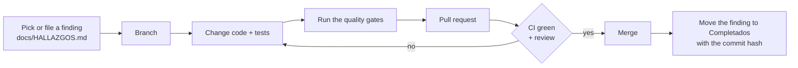
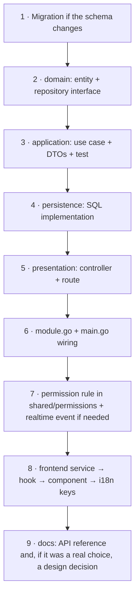

**🌐 English** · [Español](../es/contributing.md)

# Contributing

Thanks for helping. This page is the shortest path from idea to merged change.

## 1. Workflow



Work is tracked in [HALLAZGOS.md](../HALLAZGOS.md) (open issues) and [ROADMAP.md](../ROADMAP.md) (phases), both in Spanish. When you resolve a finding, move it to **Completados** with the commit hash.

## 2. Quality gates (the same ones CI runs)

```bash
# backend/
gofmt -l .            # must print nothing
go vet ./...
go build ./...
go test -race ./...

# frontend/
bunx tsc --noEmit
bun run lint
bun run test
bun run build
```

## 3. Rules that keep the codebase healthy

| Area | Rule | Why |
|---|---|---|
| Authorization | Every permission check goes through `internal/shared/permissions` | One place to audit; no ad-hoc role comparisons |
| Database | Never edit an applied migration; add a numbered `.up.sql` / `.down.sql` pair | Every environment converges on one schema |
| Layers | `domain` knows nothing about Gin, SQL or Redis; controllers call use cases, not repositories | Testable business rules |
| Modules | Cross-module access through small interfaces wired in `main.go` | No import cycles; extractable modules |
| Configuration | New variable ⇒ also add it to `backend/.env.example` | The template is the source of truth |
| Secrets | Never read, paste or commit `.env*` files, keys or tokens | They stay out of the history |
| UI text | No hard-coded strings: add the key to `en.ts` **and** `es.ts` and use `t()` | Both languages stay complete |
| UI colours | Use semantic Tailwind tokens, never hard-coded colours | Dark mode keeps working |
| Tests | New use case ⇒ unit test with fakes; new pure helper ⇒ Vitest test | The suite is the safety net |

## 4. Adding a feature: a worked path



## 5. Commits and pull requests

- Small, focused commits with an imperative subject (`Add ban expiry to bans`).
- Explain the **why** in the body when it is not obvious.
- A pull request should say what changed, how you verified it, and link the finding it resolves.

## 6. Documentation

Documentation lives in `docs/en/` and `docs/es/` with identical file names. **Change both languages in the same pull request**, and keep the language switch on the first line of each page. Diagrams use [Mermaid](https://mermaid.js.org/), which GitHub renders directly. When you take a decision that someone will later question, add an entry to `decisions.md`.

## 7. Reporting security issues

Do not open a public issue. See [Security](security.md#8-reporting-a-vulnerability).
