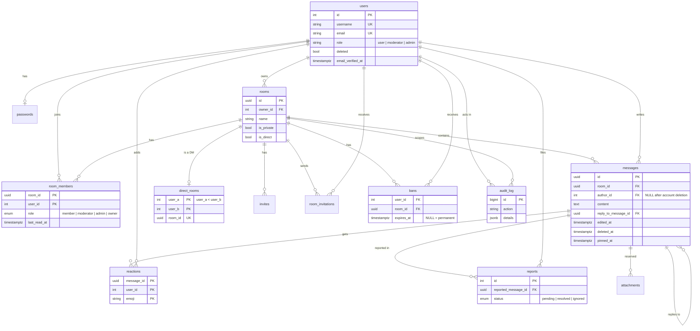

**🌐 English** · [Español](../es/data-model.md)

# Data model

PostgreSQL 16. The schema is defined by the files in `backend/migrations/` and applied on startup.

## Design notes

| Topic | Decision |
|---|---|
| Identifiers | `users` use serial integers; `rooms`, `messages` and `attachments` use UUIDs so they can be created and referenced from the client without leaking counts |
| Deletion | `messages.deleted_at` is a soft delete. `author_id` is `ON DELETE SET NULL`, which is what turns a deleted account into "deleted user" |
| Unread counters | `room_members.last_read_at`; the count is the number of newer messages in that room |
| Direct messages | A normal room with `is_direct`, plus `direct_rooms` guaranteeing one per pair (`CHECK (user_a < user_b)`) |
| Pinned messages | `pinned_at` plus a partial index that only covers pinned rows |
| Search | GIN full-text index on `messages.content`, accent-insensitive |
| Global role | `users.role` with a `CHECK`, changed only by `cmd/admin` |
| Refresh tokens | Their ids live in Redis. The `refresh_tokens` table from the first migration exists but is not used |
| Attachments | The table is reserved for the upcoming attachments feature; nothing writes to it yet |

## Main indexes

| Index | Serves |
|---|---|
| `messages (room_id, created_at DESC)` | history pagination |
| `messages (room_id, pinned_at DESC) WHERE pinned_at IS NOT NULL` | pinned list |
| `messages USING GIN (to_tsvector('simple', content))` | search |
| `invites (room_id, expires_at)` | active invitations |
| `audit_log (room_id, created_at DESC)` | per-room audit view |
| `users (name, username) WHERE deleted = FALSE` | directory default listing (empty query), migration 16 |
| `room_members (room_id, joined_at, user_id)` | member list order, migration 16 |

## Migration history

| # | Change |
|---|---|
| 1 | Initial schema |
| 2 | Unread tracking (`last_read_at`) |
| 3 | Pinned messages |
| 4 | Direct messages |
| 5–6 | Full-text search, then accent-insensitive |
| 7 | `moderator` room role |
| 8 | Global roles and `audit_log` |
| 9 | One report per person per message |
| 10 | Account deletion support |
| 11 | Invitations addressed to a user (`room_invitations`) |
| 16 | Performance indexes: directory ordering and member list order |

Rule: never edit an applied migration. Add a new numbered pair of `.up.sql` and `.down.sql` files.
