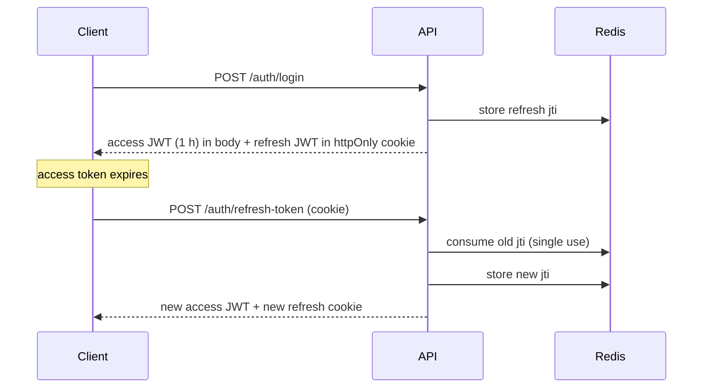
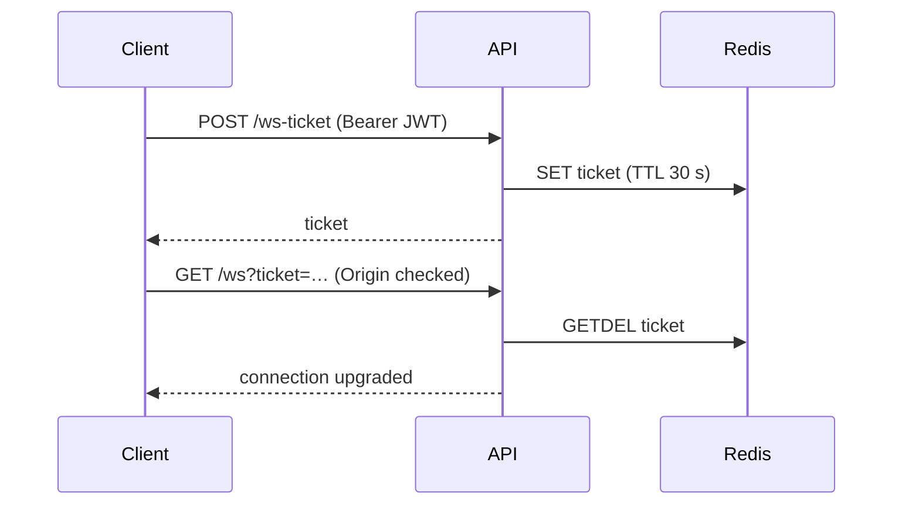

**🌐 English** · [Español](../es/decisions.md)

# Design decisions

Each entry records the **context**, the **decision**, the **alternatives** that were weighed and the **consequences** we accept. When a decision changes, add a new entry instead of rewriting history.

| # | Decision | Status |
|---|---|---|
| D1 | Modular monolith with Clean Architecture | Accepted |
| D2 | Go + Gin for the backend | Accepted |
| D3 | PostgreSQL as the source of truth, Redis for ephemeral state | Accepted |
| D4 | Versioned SQL migrations (golang-migrate), applied on startup | Accepted |
| D5 | Short access JWT + rotating refresh token in an httpOnly cookie | Accepted |
| D6 | Access token only in memory on the client | Accepted |
| D7 | WebSocket authenticated with a single-use ticket | Accepted |
| D8 | Redis pub/sub as the cross-instance event bus | Accepted |
| D9 | One rank-based permission matrix | Accepted |
| D10 | Direct messages are private rooms | Accepted |
| D11 | Cursor pagination | Accepted |
| D12 | Full-text search inside PostgreSQL | Accepted |
| D13 | Soft delete for messages, anonymisation for accounts | Accepted |
| D14 | Global roles granted only through a CLI | Accepted |
| D15 | Dependency-free i18n and CSS-variable theming | Accepted |
| D16 | Optimistic sending with explicit states | Accepted |

---

## D1. Modular monolith with Clean Architecture

- **Context:** a small team, one deployable product, but a domain (auth, rooms, messages, moderation) that will keep growing.
- **Decision:** a single Go process with one package per module; each module has `domain`, `application`, `persistence` and `presentation` layers. Modules talk to each other through small interfaces (for example `WebsocketBroadcaster`, `RoomLister`), never through each other's packages.
- **Alternatives:** microservices (operational cost with no benefit at this size); a flat "handlers + models" layout (fast to start, but business rules leak into HTTP code and become untestable).
- **Consequences:** use cases are tested with fakes and no database. Interfaces cost a little boilerplate and wiring is manual in `main.go`. If a module ever needs to be extracted, its seams already exist.

## D2. Go + Gin

- **Context:** a service dominated by many concurrent, mostly idle connections.
- **Decision:** Go for cheap goroutines and a single static binary; Gin for routing and middleware.
- **Alternatives:** Node.js (shares language with the frontend, but CPU-bound work and memory per connection scale worse); a heavier framework (more features we do not need).
- **Consequences:** the frontend and backend do not share types, so API contracts are kept by hand (an OpenAPI contract is on the roadmap).

## D3. PostgreSQL as source of truth, Redis for ephemeral state

- **Decision:** everything that must survive a restart lives in PostgreSQL. Everything with a TTL or that is shared between instances lives in Redis: refresh-token ids, WebSocket tickets, presence, rate counters and the event bus.
- **Alternatives:** keeping presence in the process (breaks with more than one instance); storing sessions in PostgreSQL (extra write load for data that is meant to expire).
- **Consequences:** two stateful dependencies to operate. The rate limiter **fails open**: if Redis is down, requests are allowed and the problem is logged, because availability matters more than strictness there.

## D4. Versioned SQL migrations

- **Context:** the first version created tables by hand from a `schema.sql`.
- **Decision:** golang-migrate files (`NNNNNN_name.up.sql` / `.down.sql`) embedded in the binary and applied on startup. A legacy hand-built database is adopted at version 1.
- **Rules:** never edit an applied migration; add a new numbered pair.
- **Consequences:** a fresh clone, CI and production converge on the same schema. Starting a new instance can briefly run migrations, which is acceptable at this scale.

## D5. Short access JWT + rotating refresh token

- **Decision:** a 1-hour access token returned in the body, and a 7-day refresh token whose id (`jti`) is stored in Redis and can be used **once**. Using it issues a new pair.
- **Why rotation:** a stolen refresh token stops working as soon as the legitimate client refreshes, and a replayed one is detectable. `POST /auth/logout` revokes the current id.
- **Alternatives:** long-lived access tokens (a leak is valid for days); server-side sessions (simpler revocation, but needs sticky state on every request).

## D6. Access token only in memory on the client

- **Decision:** the browser keeps the access token in a JavaScript variable (`lib/tokenStorage.ts`), never in `localStorage`. The refresh token is an httpOnly, `SameSite=Strict` cookie scoped to `/api/v1/auth`. On reload, `AuthContext` restores the session by calling refresh.
- **Why:** any XSS can read `localStorage`; it cannot read an httpOnly cookie, and the in-memory token disappears with the page.
- **Consequences:** one extra request on page load, and the axios interceptor must transparently refresh on `401`.

## D7. WebSocket authenticated with a single-use ticket

- **Context:** browsers cannot set an `Authorization` header on a WebSocket, so the token would end up in the URL, where proxies and logs record it.
- **Decision:** exchange the JWT for a 30-second, single-use ticket. The server also checks the `Origin` header against `CORS_ALLOWED_ORIGINS`.
- **Consequences:** a leaked URL is useless within seconds and cannot be replayed.

## D8. Redis pub/sub as the event bus

- **Decision:** the hub publishes every event to one Redis channel; each instance delivers it to its own connected clients. Presence is a Redis sorted set shared by all instances.
- **Alternatives:** sticky sessions (uneven load, and a room's members may sit on different instances anyway); Kafka/NATS (more infrastructure than the problem needs).
- **Consequences:** delivery is at-most-once. Clients reconnect with backoff and reload recent history to recover what they missed.

## D9. One rank-based permission matrix

- **Context:** moderation, pinning, invitations and deletion each had their own role comparison, which is where authorization bugs hide.
- **Decision:** `internal/shared/permissions` is the only place that decides who may do what. Room roles (`member < moderator < admin < owner`) and global roles map to a numeric rank, and rules read "the actor must **strictly outrank** the target".
- **Rule for contributors:** new checks go through that package, never through ad-hoc string comparisons. The frontend mirrors the matrix in `lib/permissions.ts` only to decide what to *show*; the server always decides.

## D10. Direct messages are private rooms

- **Decision:** a one-to-one chat is a private room with `is_direct = true`, one per pair of users (`direct_rooms`, with `user_a < user_b` enforced by a `CHECK`).
- **Why:** history, unread counters, search, reactions, presence and WebSocket delivery work with **no new code**.
- **Consequences:** a few features branch on `is_direct` (no member list, no reporting).

## D11. Cursor pagination

- **Decision:** history is paged by cursor (`?limit=&before=`) over `(room_id, created_at DESC)`.
- **Alternatives:** `OFFSET` pagination skips or repeats rows when new messages arrive and gets slower with depth.

## D12. Full-text search inside PostgreSQL

- **Decision:** a GIN index on `to_tsvector('simple', content)` with accent-insensitive matching (`unaccent`), limited to rooms the user belongs to.
- **Alternatives:** Elasticsearch/Meilisearch give better ranking but add a service to run and keep in sync. Revisit if search becomes a core feature.

## D13. Soft delete for messages, anonymisation for accounts

- **Decision:** deleting a message sets `deleted_at`, so threads, reports and the audit trail stay coherent. Deleting an account passes owned rooms to another member (or removes them if the owner is alone), and keeps messages shown as "deleted user" (`author_id` becomes `NULL`).
- **Why:** it honours a person's right to erase their data without breaking other people's conversations. `GET /users/export` provides the matching data export.

## D14. Global roles only through a CLI

- **Decision:** `users.role` (`user | moderator | admin`) is never writable through the HTTP API. It is granted with `cmd/admin` (`make admin-grant`).
- **Why:** there is no endpoint to attack for privilege escalation; whoever can reach the database decides who is an admin.

## D15. Dependency-free i18n and CSS-variable theming

- **Decision:** typed dictionaries (`en.ts` is the source of truth for keys, `es.ts` must satisfy the same type) and a `useT()` hook; light and dark themes through CSS variables and semantic Tailwind tokens.
- **Why:** the app has two languages and a few hundred strings, which does not justify a routing-aware i18n framework. A missing translation is a compile error, and a test checks that placeholders match in both languages.
- **Consequences:** the language is chosen on the client, so server-rendered HTML is English and may flash briefly before hydration. If SEO-relevant public pages appear, revisit with locale-prefixed routes.

## D16. Optimistic sending with explicit states

- **Decision:** a message appears immediately as *sending*, and becomes *not sent* with **Retry** and **Discard** on failure.
- **Why:** unstable networks are normal on mobile; hiding failures loses messages silently.
