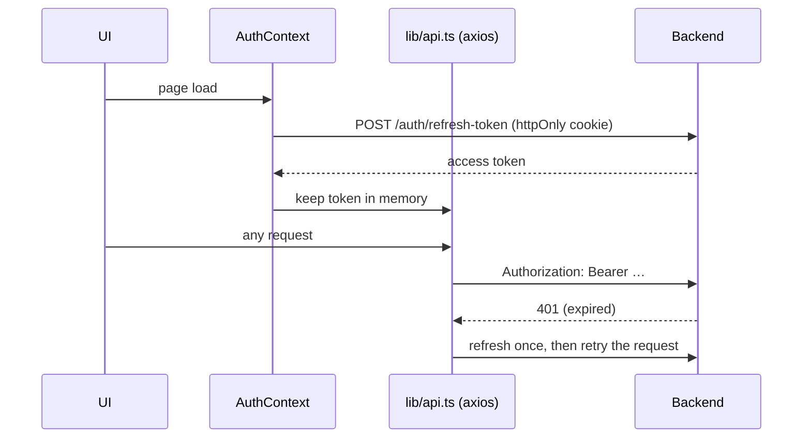
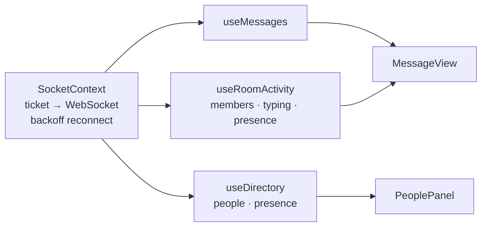
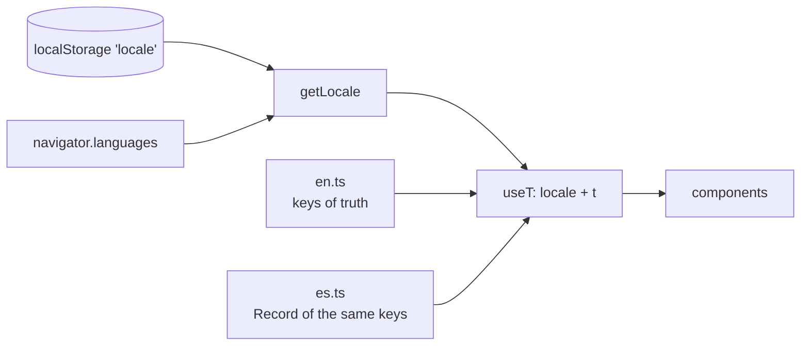

**🌐 English** · [Español](../es/frontend.md)

# Frontend

Next.js 16 (App Router), React 19, TypeScript, Tailwind CSS 3. Run everything from `frontend/` with Bun.

## 1. Structure

```
src/
  app/              routes: (auth) login, register, verify · (private) dashboard, profile
  components/       feature components + ui/ primitives (shadcn-style, Radix + cva)
  contexts/         AuthContext, SocketContext
  hooks/            useMessages, useRoom, useRoomActivity, useUser, useAuth, useSocket
  services/         one *Service.ts per API area, all through lib/api.ts
  lib/              api, tokenStorage, permissions, theme, backoff, typing, unread, i18n/
```

## 2. Session flow



The access token is never persisted (see D6 in [Design decisions](decisions.md)). `PrivateRoute` guards the `(private)` group.

Sessions survive closing the tab: the restore step retries transient failures (`lib/sessionRestore.ts`) and the user is signed out only when the server rejects the refresh token (401/403), never because of a network error (D20). The `/forgot-password` and `/reset-password/[token]` pages implement the password reset (D21); their error messages are mapped to translated texts by `lib/resetErrors.ts`, so no server text is shown raw.

## 3. Real-time in the UI



- `SocketContext` opens one connection per session and exposes it to the hooks.
- `useMessages` applies `new_message`, `update_message`, `delete_message`, `pin_message` and reaction events, and keeps **pending** messages (sending, not sent) so sends feel instant and failures are retryable.
- `useDirectory` lists everyone with online status for the always-visible `PeoplePanel`: it applies `presence` events, reloads on reconnect and every 60 s (people who share no room with you do not get live events, so their dot can lag up to a minute). `useInvitations` polls pending invitations every 15 s and on window focus; `useDiscoverRooms` lists rooms you have not joined.
- After a reconnect the hooks reload, because events sent during an outage are lost.
- `MessageView` is mounted with `key={roomId}`, so each room starts with fresh state.

## 4. Permissions in the UI

`lib/permissions.ts` mirrors the server matrix so the UI shows only the controls a user could use (pin button, role selector, moderation panel). It is a convenience: the server enforces every rule.

## 5. Visual design: "Foco"

The interface follows the **Foco** direction, chosen from three proposals (Foco, Calidez, Redacción): a dense, fast, team-oriented look with a cool neutral scale and **one** indigo accent.

| Element | Rule |
|---|---|
| Rooms | `#` prefix in the mono font, a lock for private rooms, `@` for direct messages; selected row uses the tinted accent (`bg-soft text-primary`) |
| Unread | bold name plus a `bg-primary` pill |
| Messages | bordered cards: avatar with initials, bold author (click it to open a direct message), role label for owner, admin and moderator, mono timestamp; yours are tinted and aligned right; reply, pin, report and delete appear on hover (always visible on touch screens) |
| Direct messages | the header shows the other person's avatar, online status and @username; the sidebar lists them with avatars; an empty conversation shows a start-of-conversation note |
| Reactions | pills; the ones you added use `border-primary bg-soft`. The add button exists on every message (on hover when it has none): a quick row of six emojis plus the full picker (`EmojiPicker`, a floating layer so it is never clipped). On your own messages the quick row opens towards the left |
| Composer | emoji button that inserts into the draft |
| People | `PeoplePanel`: a right column, always visible on wide screens (at the end of the sidebar on small ones), with search, online first and presence dots; click a person to write to them |
| Explore | `DiscoverRooms` in the sidebar: public rooms have a Join button; private ones show a lock and "invitation only" |
| Invitations | received ones appear on top of the sidebar with Accept and Decline; owners and admins get an invite button in the room header (`InviteUsers`) |
| Notifications | the bell in the sidebar header opens two switches (kept per browser): a short synthesized chime (one note for rooms, a rising pair for direct messages) and operating-system notifications, which ask the browser for permission when switched on. Nothing fires for your own messages or for the conversation you are reading; desktop notifications appear only while the page is in the background, and clicking one opens that conversation. The tab title shows the unread total, e.g. `(3) WebChat`. The decision rules live in `lib/alerts.ts` (unit-tested); audio needs a prior click on the page, which a normal session always has |
| Onboarding | `OnboardingDialog`: a three-step welcome (people, rooms, talking) shown once per person; skipping or finishing stores `onboarding:<userId>` in `localStorage`, and the help button next to the language switch reopens it. Empty states (no rooms, no room open) say what to do next |
| Room members | side panel (overlay on small screens) kept for roles, removing and banning |
| Type | Inter for text, JetBrains Mono (`font-mono`) for hashes, times and counters |
| Shape | 8 px base radius, hairline borders, no shadows except overlays |

New tokens next to the shadcn ones: `soft` (accent tint) and `success` (online dot). `Avatar` renders the initials (`lib/initials.ts`).

### Theming

Light and dark palettes are CSS variables in `app/globals.css`. An inline script in `<head>` sets the `dark` class before first paint, following the operating system unless the user chose (stored in `localStorage`). **Always use semantic Tailwind tokens** (`bg-background`, `text-muted-foreground`, `border-border`, `bg-primary`…), never hard-coded colours.

## 6. Internationalisation



| Piece | Role |
|---|---|
| `lib/i18n/en.ts` | Source of truth for every key |
| `lib/i18n/es.ts` | Typed `Record<MessageKey, string>`: a missing key fails type-checking |
| `lib/i18n/index.ts` | `resolveLocale`, `translate` (`{param}` interpolation), `intlLocale` |
| `lib/i18n/useT.ts` | `useT()`, `setLocale`, `useHtmlLang` (store built on `useSyncExternalStore`) |
| `LanguageToggle` | EN / ES switch in the user panel and on the auth screens |

**To add a string:** add the key to `en.ts` and `es.ts`, then use `t('your.key', { param })`. A test checks that both languages use the same placeholders. Schemas that carry messages (zod) are factories that take `t`, for example `makeRegisterSchema(t)`. Dates and times use `intlLocale(locale)`.

## 7. Quality gates

```bash
bunx tsc --noEmit && bun run lint && bun run test && bun run build
```
