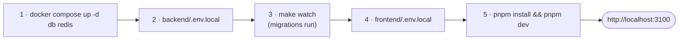

**🌐 English** · [Español](../es/getting-started.md)

# Getting started

## 1. Requirements

Go 1.27.3+, Node 24+ and pnpm (the version is pinned in `package.json`; `corepack enable` or `npm i -g pnpm`), Docker with Compose, Make, `air` (live reload; `make watch` offers to install it) and `openssl`.

## 2. Ports

| Service | Port on your machine | Container |
|---|---|---|
| Frontend | 3100 | runs outside Docker |
| Backend | 8081 | `webchat-api` (Docker mode only) |
| PostgreSQL | 5433 | `webchat-db` |
| Redis | 6380 | `webchat-redis` |

Everything is published only on `127.0.0.1`. The ports avoid clashes with other local projects; keep `PORT`, `CORS_ALLOWED_ORIGINS` and `NEXT_PUBLIC_API_URL` consistent with them.

## 3. Quick start



```bash
# 1. Database and cache
cd backend && docker compose up -d db redis

# 2. Backend: copy the template, fill every <...>, then
cp .env.example .env.local
make watch                         # http://localhost:8081

# 3. Frontend
cd ../frontend && cp .env.example .env.local
pnpm install && pnpm dev             # http://localhost:3100 (bound to 127.0.0.1; DEV_HOST=0.0.0.0 pnpm dev to test from a phone)
```

### Or with the root Makefile

Once the two `.env.local` files exist, everything can be run from the repository root:

```bash
make setup     # frontend dependencies + Go modules (once)
make dev       # Postgres + Redis in Docker, backend with live reload, and the frontend
make help      # list every target
```

Other targets: `make check` (what CI checks: vet, gofmt, tsc, lint, tests, builds), `make test-integration` (backend tests against throwaway Postgres and Redis), `make infra-up` / `infra-down`, `make up-dev` / `make down`, `make admin-grant EMAIL=… ROLE=admin`. They delegate to `backend/Makefile` and pnpm, so the old commands keep working.

The database passwords are defined in `backend/docker-compose.yml`; copy them into `.env.local`. **Never commit real env files**: only the `.env.example` templates are versioned.

## 4. Environment variables (backend)

The template `backend/.env.example` is the source of truth. The important ones:

| Variable | Required | Notes |
|---|---|---|
| `JWT_SECRET` | **Yes** | At least 32 characters (`openssl rand -hex 32`). The server refuses to start without it |
| `DATABASE_URL` | One of the two | Takes precedence over `DB_*` |
| `DB_HOST`, `DB_PORT`, `DB_USER`, `DB_NAME`, `DB_PASSWORD` | If no `DATABASE_URL` | Local Postgres is on port 5433 |
| `REDIS_URL` | One of the two | Takes precedence over `REDIS_*`. **Redis 6.2 or later** (the rate limiter uses a Lua script, `GETDEL` needs 6.2); tested on 6.2 and 8 |
| `REDIS_HOST`, `REDIS_PORT`, `REDIS_PASS` | If no `REDIS_URL` | Local Redis is on port 6380 |
| `CORS_ALLOWED_ORIGINS` | In practice yes | Comma separated; must include the frontend origin. Also used for the WebSocket `Origin` check |
| `SMTP_HOST`, `SMTP_PORT`, `SMTP_FROM`, `SMTP_PASSWORD` | Only for password reset | Without them "Forgot your password?" sends nothing (the error is only logged). A test SMTP server such as Mailpit works locally |
| `DB_MAX_OPEN_CONNS`, `DB_MAX_IDLE_CONNS`, `DB_CONN_MAX_LIFETIME`, `DB_CONN_MAX_IDLE_TIME` | No | Postgres pool: defaults 25, 25, `30m`, `5m` (durations in Go format). Idle must not exceed open; a bad value stops startup |
| `TRUSTED_PROXIES` | Behind a load balancer | Comma-separated IPs/CIDRs whose `X-Forwarded-For` is trusted; empty by default. Without it every user behind the proxy shares one rate-limit bucket |
| `PORT` | No | Default 8081 |
| `FRONTEND_URL` | No | Used in email links |
| `APP_ENV` | Recommended | **Secure by default**: anything except an explicit `dev`, `development`, `local` or `test` counts as production (Secure refresh cookie, Gin release mode, JSON logs), so a deployment that forgets it is still safe. Set `APP_ENV=dev` to run over plain `http` locally (Safari does not store Secure cookies on `http://localhost`). The server logs a warning at startup when it is not explicitly `prod`/`production` |

Frontend: a single variable, `NEXT_PUBLIC_API_URL` (default `http://localhost:8081/api/v1`).

Which file is loaded by what:

| File | Used by |
|---|---|
| `backend/.env.local` | `make run`, `make watch` (backend on your machine) |
| `backend/.env.dev` | `make up-dev` (backend in Docker) |
| `backend/.env.prod` | `make up-prod` |
| `frontend/.env.local` | `pnpm dev` |

Inside Docker, hosts and ports are the internal ones (`DB_HOST=db`, `DB_PORT=5432`, `REDIS_HOST=redis`, `REDIS_PORT=6379`).

## 5. Check that it works

1. Open `http://localhost:3100/register` and create a user.
2. Sign in, create a room and send a message.
3. In a private window, create a second user. Both appear in each other's **People** panel; from the first user open the room, press the invite button in its header and invite the second, who accepts from the **Invitations** block at the top of the sidebar.
4. Messages should arrive in both windows **without reloading**: that proves the WebSocket works.
5. Edit a message, react to it, pin it.

Handy checks:

```bash
curl -s http://localhost:8081/health
curl -s http://localhost:8081/ready
docker exec -it webchat-db psql -U root -d webchat -c 'select * from schema_migrations'
```

## 6. Administration

Global roles are granted only from the server:

```bash
cd backend
make admin-grant EMAIL=you@example.com ROLE=admin     # admin | moderator
make admin-list
make admin-revoke EMAIL=you@example.com
```

## 7. Everyday commands

| Where | Command | What it does |
|---|---|---|
| root | `make dev` · `make check` · `make test-integration` · `make help` | everything from one place |
| `backend/` | `make watch` / `make run` | run with / without live reload |
| `backend/` | `make test` | `go test -v ./...` |
| `backend/` | `make up-dev` / `make down` | whole stack in Docker / stop it |
| `backend/` | `docker compose down -v` | stop **and delete all data** |
| `frontend/` | `pnpm dev` · `pnpm run build` · `pnpm run lint` · `pnpm run test` | frontend tasks |

## 8. Troubleshooting

| Symptom | Likely cause | Fix |
|---|---|---|
| `JWT_SECRET must be set and at least 32 characters long` | Missing or short secret | Set it in `.env.local` |
| `DATABASE_URL is not set…` | `.env.local` not loaded | Run `make watch` from `backend/` |
| `unable to connect to database` | Container down, wrong port or password | `docker compose ps`; use port **5433** locally |
| Redis error at startup | Wrong port or password | Use port **6380** locally |
| `bind: address already in use` | Another project owns the port | `ss -ltnp \| grep <port>` |
| Frontend loads but shows CORS errors | Origin missing from `CORS_ALLOWED_ORIGINS` | Add `http://localhost:3100` and restart |
| Requests go to `undefined/...` | No `frontend/.env.local` | Create it and restart `pnpm dev` |
| `air: command not found` | `air` not installed | `go install github.com/air-verse/air@latest` |

The original Spanish guide with extra detail is [LEVANTAR.md](../LEVANTAR.md).
