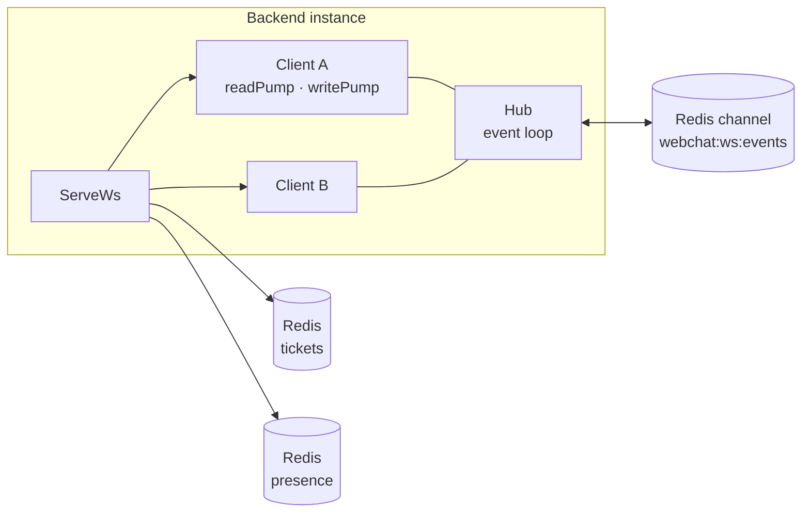
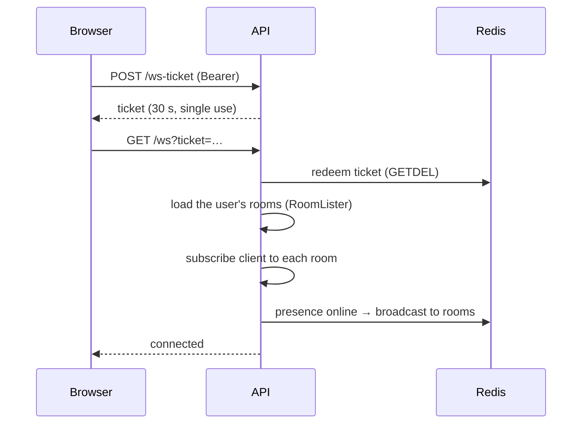
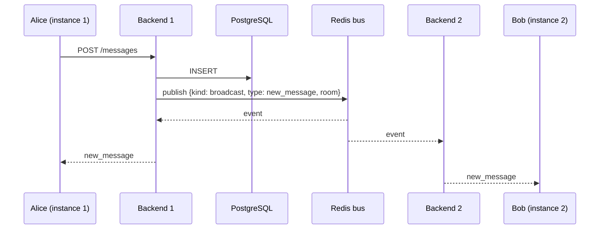
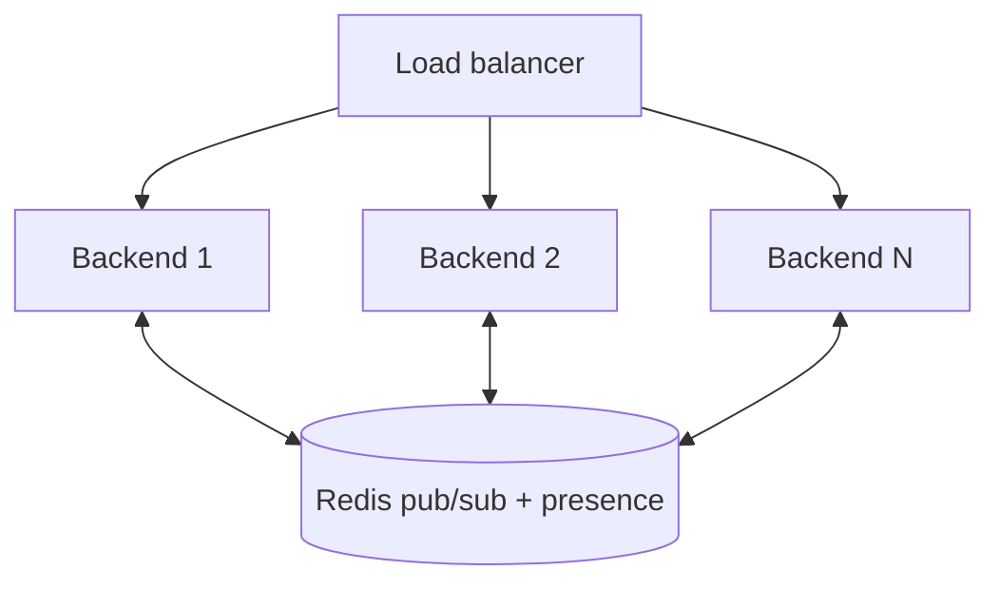

**🌐 English** · [Español](../es/realtime.md)

# Real-time

## 1. Components

- **Hub:** a single event loop that tracks which clients belong to which room.
- **Client:** one per connection, with a read pump and a write pump (goroutines).
- **Bus:** publishes every event to Redis so all instances deliver it to *their* clients.
- **Presence:** a Redis sorted set of `userID:clientID` scored by last heartbeat. A user is online if at least one connection beat within the last 2 minutes. `presence` events go to the rooms the user is in; the people directory also asks the server for everyone's status on load, on reconnect and every 60 s.

## 2. Connecting

## 3. Sending a message

The sender also receives the event, which is how the optimistic message gets confirmed.

## 4. Events

Server → client, with `type` and `payload`:

| Type | Sent when |
|---|---|
| `new_message` | a message is created |
| `update_message` | a message is edited |
| `delete_message` | a message is deleted (by the author or a moderator) |
| `pin_message` | a message is pinned or unpinned |
| `reaction_added`, `reaction_removed` | reactions change |
| `role_changed`, `member_removed` | a member's role changes or they are removed |
| `typing` | a member is typing (ephemeral, never stored) |
| `presence` | a member goes online or offline |

Client → server: only `{ "type": "typing", "room_id": … }`, accepted from room members and throttled.

Between instances the bus carries four kinds: `broadcast`, `subscribe`, `unsubscribe` and `disconnect`. The last three apply a membership change (joining a room, being kicked, deleting an account) to whichever instance holds the user's connection.

## 5. Reliability model

- **At-most-once delivery.** If a client is offline, it misses events. This is a deliberate trade-off against the cost of an event log (see D8 in [Design decisions](decisions.md)).
- **Recovery on the client.** `SocketContext` reconnects with exponential backoff (`lib/backoff.ts`) and requests a new ticket each time. After a reconnect, `useMessages` and `useRoomActivity` reload the latest messages and members, so the screen converges to the true state.
- **Source of truth.** The database. Events are hints that make the UI fast; a reload always repairs it.

## 6. Scaling out

No sticky sessions are required: a client may connect to any instance and still see events originating from the others. Capacity planning and load tests (k6) are on the roadmap.
