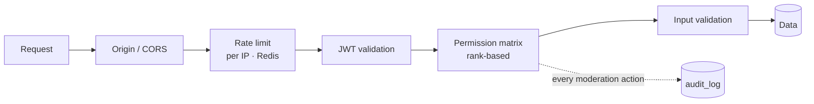
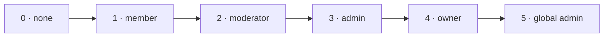

**🌐 English** · [Español](../es/security.md)

# Security

Security is layered: no single control is trusted on its own.

## 1. Authentication

| Item | Behaviour |
|---|---|
| Passwords | bcrypt hashes in their own table (`passwords`), never returned by the API |
| Password policy | 8–72 characters (72 is bcrypt's limit); rejects a short list of very common passwords and passwords containing the username or the email's local part |
| Access token | JWT, 1 hour, sent as `Authorization: Bearer …` |
| Refresh token | JWT, 7 days, **single use** and rotated within a *family* (one per login). A replay inside the 30 s grace gets the same successor back (no second chain); an already-rotated token presented after the grace revokes the whole family; a session ends at most 30 days after login however active it is; id stored in Redis (tokens issued before families existed start theirs on their first renewal); httpOnly, `SameSite=Strict` cookie scoped to `/api/v1/auth` |
| Session persistence | every renewal issues a fresh 7 days, so the session ends after a week **without use**; the browser signs out only when the server rejects the token, never on a network error (D20) |
| Token types and live sessions | every JWT carries `typ` (`access`/`refresh`/`verify`) and consumers require their own; HS256 only. A session guard rejects tokens issued before a revocation and tokens of deactivated users on every request (D23). Deactivating needs the password and ends sessions and sockets immediately |
| Identity | usernames are `[A-Za-z0-9_.-]` (3–30); email and username are unique case-insensitively; login and reset take the same time for unknown accounts; bcrypt cost 12 |
| Limits | request bodies ≤ 1 MiB, server timeouts, per-IP rate limits on every mutating route, `TRUSTED_PROXIES` behind a load balancer (D27). Message edits need membership and cap content at 4000 characters; reactions are capped (10 distinct per person, 30 per message) |
| API hardening | every response carries `X-Content-Type-Options: nosniff`, and `/api/...` answers `Cache-Control: no-store` (token bodies and authenticated JSON are never cached); 500s and invalid bodies return generic messages (details only in the log); JSON over 1 KiB is gzip-compressed; CORS preflight is cacheable for 2 h; `/docs` loads its pinned Scalar script with a Subresource Integrity hash; Redis calls on the request path time out within 0.5 s (fail open) |
| Production defaults | the refresh cookie `Secure` flag and Gin release mode do not depend on an optional variable: only an explicit `APP_ENV` of `dev`/`development`/`local`/`test` relaxes them, and the server logs a warning at startup unless `APP_ENV` is `prod`/`production` |
| Browser | security headers and a CSP on the web app (D25); client errors are logged without request bodies or credentials |
| Password reset | `POST /auth/forgot-password` always answers the same, so it never reveals who has an account. The emailed link carries a random 256-bit token valid 30 minutes and **single use** (redeemed atomically with `GETDEL`; a newer link replaces the older one); only its SHA-256 hash is stored. The email never includes the account name. At most one email per address per minute, plus a per-client rate limit. `POST /auth/reset-password` applies the registration password policy (a refused password leaves the link valid), then **ends every session**: refresh tokens issued before that moment are rejected (access tokens expire within the hour) (D21) |
| Logout | `POST /auth/logout` revokes the refresh id, clears the cookie and cuts the user's open sockets (other tabs reconnect on their own) |
| Secret | the server refuses to start without a `JWT_SECRET` of at least 32 characters |
| Login errors | the login form shows one generic message, so it does not reveal whether an email exists |

The reasoning behind each choice is in [Design decisions](decisions.md) (D5–D7, D20, D21).

## 2. WebSocket

- The JWT never appears in a URL: `POST /ws-ticket` returns a 30-second, single-use ticket stored in Redis.
- The `Origin` header must match `CORS_ALLOWED_ORIGINS`.
- A client can only announce `typing` in a room it is subscribed to, and no more often than a fixed interval.
- When a member is removed or banned, their connection is unsubscribed from the room (or disconnected on account deletion).

## 3. Authorization: the permission matrix

Everything lives in `internal/shared/permissions`. Room roles and global roles collapse into one **rank**:

A global **moderator** acts as a moderator in every room; a global **admin** outranks every room owner.

| Action | Minimum rank |
|---|---|
| Read a room, send messages | 1 · member |
| Delete other people's messages, resolve reports | 2 · moderator |
| Kick or ban a user | 2 · moderator **and strictly above the target** |
| Pin messages, create invitations (codes or personal) | 3 · admin |
| Change roles | 3 · admin, only for members below them: admins can make moderators, only owners (or global admins) can make admins; the owner role is never assigned |
| Read the audit log | 3 · admin |

Because rules compare ranks, a moderator can never act on another moderator, an admin, or the owner.

## 4. Abuse protection

Rate limits are per client IP, kept in Redis (`/api/v1`). IPv6 clients are grouped by their `/64` prefix, so rotating addresses inside one allocation does not give a fresh allowance. The counter is a small Lua script (works on Redis 6.2+, not only 7+):

| Route | Limit |
|---|---|
| `POST /auth/login` | 10 per minute |
| `POST /auth/register` | 20 per 10 minutes |
| `POST /auth/refresh-token` | 30 per minute |
| `POST /auth/send-verify-email/:user_id` | 5 per 10 minutes |
| `POST /ws-ticket` | 30 per minute |
| `POST /messages` | 120 per minute |
| `POST /rooms/read/:room_id` | 240 per minute |
| `GET /messages/search` | 60 per minute |
| `GET /users/export`, `DELETE /users/me` | 5 per hour each |

When exceeded the API answers `429` with a `Retry-After` header. If Redis is unavailable the limiter lets traffic through and logs the failure. Behind a reverse proxy, configure trusted proxies so the client IP cannot be spoofed.

## 5. Moderation and audit

- Members report messages (one report per person, never your own). Moderators review the queue and can delete the message, mark the report resolved or ignore it.
- Bans are per room, temporary or permanent, and prevent re-joining by id or invitation.
- Every sensitive action is written to `audit_log` with actor, target, room and details. Only admins read it.

## 6. Privacy

- **Directory and discovery:** any signed-in user can list other active users (name, username, online status) and every room's name, topic and member count. Reading or writing in a room still needs membership, so a private room is visible but closed. Personal invitations can only be answered by the invited user (anyone else gets "not found"), and accepting re-checks bans.
- `GET /users/export` downloads a JSON file with the user's profile, rooms, messages and reactions, streamed row by row so a large account never sits fully in server memory.
- `DELETE /users/me` (confirmed with the password) deletes the account: see D13 in [Design decisions](decisions.md).

## 7. Known limits

The directory exposes names and usernames to every signed-in user: fine for a team server, but a public deployment would need a visibility setting (see D18 in [Design decisions](decisions.md)).

Email verification is implemented but **paused**, and `POST /auth/send-verify-email/:user_id` is still public (tracked as H-008 in the findings tracker). Docker Compose still carries database passwords in the file (H-051).

## 8. Reporting a vulnerability

Please do not open a public issue. Contact the maintainers privately and include steps to reproduce.
