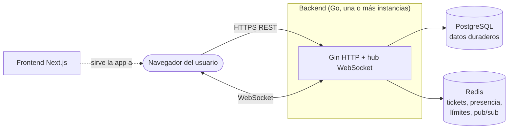

[English](../en/README.md) · **🌐 Español**

# Documentación de WebChat

WebChat es una plataforma de chat en tiempo real: salas, un directorio de personas con presencia, mensajes directos, invitaciones personales, reacciones con emojis, mensajes fijados, búsqueda y herramientas de moderación. Esta documentación explica **cómo funciona** y, sobre todo, **por qué se construyó así**.

## Guía de lectura

| Si quieres… | Lee |
|---|---|
| Ejecutarlo en tu máquina | [Primeros pasos](getting-started.md) |
| Entender el panorama general | [Arquitectura](architecture.md) |
| Saber por qué se eligió una tecnología o patrón | [Decisiones de diseño](decisions.md) |
| Entender login, tokens, permisos y protección contra abuso | [Seguridad](security.md) |
| Entender la mensajería en vivo, la presencia y el escalado | [Tiempo real](realtime.md) |
| Ver las tablas y sus relaciones | [Modelo de datos](data-model.md) |
| Llamar a la API | [Referencia de la API](api.md) · interactiva en `/docs` (Scalar) |
| Trabajar en la interfaz | [Frontend](frontend.md) |
| Enviar un cambio | [Contribuir](contributing.md) |

## Mapa del sistema

## Documentos del proyecto

Son los documentos de trabajo del equipo: [Roadmap](../ROADMAP.md), [Casos de uso](../CASOS_DE_USO.md), [Registro de hallazgos](../HALLAZGOS.md) y la [guía original para levantar el proyecto](../LEVANTAR.md), con solución de problemas.
