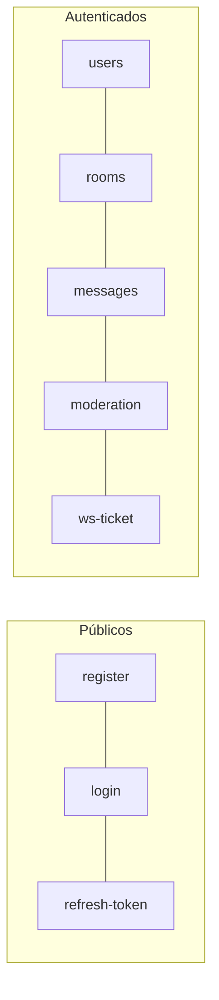

[English](../en/api.md) · **🌐 Español**

# Referencia de la API

> **Referencia interactiva:** levanta el backend y abre **[http://localhost:8081/docs](http://localhost:8081/docs)** ([Scalar](https://scalar.com)). Muestra el contrato OpenAPI 3.1, permite probar cada endpoint y genera ejemplos de código. El contrato en bruto se sirve en `/openapi.yaml` y vive en [`backend/api/openapi.yaml`](../../backend/api/openapi.yaml). Las tablas de abajo son un resumen rápido; el contrato es la fuente de verdad detallada.

URL base en desarrollo: `http://localhost:8081/api/v1` (los health checks están fuera del prefijo). JSON de entrada y de salida.

**Autenticación:** todos los endpoints, salvo los marcados como *público*, requieren `Authorization: Bearer <access token>`.

**Errores:** una respuesta no 2xx lleva `{ "error": "mensaje" }`. Estados habituales: `400` entrada inválida, `401` token ausente o caducado, `403` no permitido, `404` no encontrado, `409` conflicto, `429` límite excedido (con `Retry-After`).



## Health

| Método | Ruta | Descripción |
|---|---|---|
| GET | `/health` | Liveness. Siempre `200 {"status":"ok"}` *(público)* |
| GET | `/ready` | Readiness. Comprueba la base de datos y Redis; `503` si alguna falla *(público)* |

## Auth `/auth`

| Método | Ruta | Descripción |
|---|---|---|
| POST | `/auth/register` | Crea una cuenta: `name`, `last_name`, `username` (3–30), `email`, `phone`, `password` (8–72) *(público)* |
| POST | `/auth/login` | `{ user, password }` devuelve `{ user, token }` (el access token) y fija la cookie `refresh_token` *(público)* |
| POST | `/auth/refresh-token` | Rota la cookie de refresh y devuelve un nuevo access token *(público, necesita la cookie)* |
| POST | `/auth/logout` | Revoca el refresh token y borra la cookie |
| POST | `/auth/forgot-password` | `{ email }` envía por correo un enlace de restablecimiento de un solo uso (30 min). Siempre responde `200`, tenga o no cuenta esa dirección *(pública)* |
| POST | `/auth/reset-password` | `{ token, password }` fija la contraseña nueva, quema el enlace y cierra la sesión en todas partes *(pública)* |
| POST | `/auth/send-verify-email/:user_id` | Envía un correo de verificación *(público; verificación pausada)* |
| POST | `/auth/verify-email/:token` | Confirma un correo *(público; pausada)* |

## Usuarios `/users`

| Método | Ruta | Descripción |
|---|---|---|
| GET | `/users/profile` | Perfil del usuario actual, incluido el `role` global |
| GET | `/users/directory?q=` | Directorio de personas con estado de conexión, las conectadas primero |
| DELETE | `/users/deactivate` | Desactiva la cuenta y cierra la sesión |
| GET | `/users/export` | Descarga todos los datos del usuario en JSON |
| DELETE | `/users/me` | Borra la cuenta de forma permanente; el cuerpo lleva la contraseña |

## Salas `/rooms`

| Método | Ruta | Descripción |
|---|---|---|
| POST | `/rooms` | Crea una sala: `name`, `topic`, `is_private`. Quien la crea queda como propietario |
| GET | `/rooms` | Las salas del usuario, con `unread_count`, `is_direct` y `my_role` |
| GET | `/rooms/discover` | Todas las salas no directas; las privadas se listan pero requieren invitación |
| POST | `/rooms/invite-user/:room_id` | Invitar a un usuario concreto (admin o superior) |
| GET | `/rooms/invitations` | Mis invitaciones pendientes |
| POST | `/rooms/invitations/:id/accept` · `/decline` | Responder una invitación; al aceptar paso a ser miembro |
| POST | `/rooms/join/:room_id` | Unirse a una sala pública (falla si está vetado) |
| POST | `/rooms/direct/:user_id` | Abre (o reutiliza) la sala 1 a 1 con ese usuario |
| GET | `/rooms/members/:room_id` | Miembros con rol y estado en línea |
| POST | `/rooms/leave/:room_id` | Salir de una sala (el propietario no puede) |
| POST | `/rooms/read/:room_id` | Marca la sala como leída |
| POST | `/rooms/invite/:room_id` | Crea una invitación (admin o superior) |
| POST | `/rooms/accept-invite/:code` | Unirse mediante un código de invitación |

## Mensajes `/messages`

| Método | Ruta | Descripción |
|---|---|---|
| GET | `/messages/:roomId/messages?limit=&before=` | Historial, del más nuevo al más antiguo, paginado por cursor |
| GET | `/messages/:roomId/pinned` | Mensajes fijados de una sala |
| GET | `/messages/search?q=&room_id=` | Búsqueda de texto completo, sin distinguir acentos, en las salas del usuario (o en una) |
| POST | `/messages` | Enviar: `room_id`, `content`, opcional `reply_to_message_id` |
| PATCH | `/messages/:id` | Editar (solo el autor) |
| DELETE | `/messages/:id` | Borrar (el autor, o un moderador o superior) |
| PUT / DELETE | `/messages/:id/pin` | Fijar / desfijar (admin o superior) |
| POST / DELETE | `/messages/:id/reactions` | Añadir / quitar una reacción con emoji |

## Moderación `/moderation`

| Método | Ruta | Rango mínimo |
|---|---|---|
| POST | `/moderation/messages/:message_id/report` | miembro (no tu propio mensaje, una vez por persona) |
| POST | `/moderation/reports/:report_id/resolve` | moderador (`{ action: "resolve" \| "ignore", delete_message }`) |
| GET | `/moderation/rooms/:room_id/reports` | moderador |
| GET | `/moderation/rooms/:room_id/bans` | moderador |
| POST | `/moderation/rooms/:room_id/bans/:user_id` | moderador, estrictamente por encima del objetivo; cuerpo `{ reason, duration }` donde `duration` es una duración de Go como `24h` (vacía = permanente) |
| DELETE | `/moderation/rooms/:room_id/bans/:user_id` | moderador |
| PATCH | `/moderation/rooms/:room_id/members/:user_id/role` | admin (ver [Seguridad](security.md)) |
| DELETE | `/moderation/rooms/:room_id/members/:user_id` | moderador, estrictamente por encima del objetivo |
| GET | `/moderation/rooms/:room_id/audit` | admin |

## WebSocket

| Método | Ruta | Descripción |
|---|---|---|
| POST | `/ws-ticket` | Devuelve un ticket de 30 segundos y un solo uso |
| GET | `/ws?ticket=…` | Actualiza a WebSocket; el `Origin` debe estar permitido |

Los tipos de evento y sus payloads se describen en [Tiempo real](realtime.md).

## Ejemplo

```bash
# iniciar sesión y guardar la cookie de refresh
curl -s -i -c jar.txt -X POST http://localhost:8081/api/v1/auth/login \
  -H 'Content-Type: application/json' \
  -d '{"user":"tu@correo.com","password":"una-clave-larga"}'

# llamar a un endpoint con el access token del cuerpo de la respuesta
curl -s http://localhost:8081/api/v1/rooms -H "Authorization: Bearer $TOKEN"

# renovar el access token con la cookie
curl -s -b jar.txt -X POST http://localhost:8081/api/v1/auth/refresh-token
```

## Mantener el contrato al día

`backend/api/openapi.yaml` se escribe a mano y va embebido en el binario (`go:embed`), así que un servidor en marcha siempre se documenta a sí mismo. **Todo cambio en una ruta, un cuerpo de petición o una respuesta debe actualizar el YAML en el mismo commit.** `go test ./api/` comprueba que el documento sea YAML válido, que cada `$ref` se resuelva, que cada operación tenga un `operationId` único, un resumen, una etiqueta y respuestas, y que el conjunto de operaciones públicas (sin autenticación) solo cambie a propósito.

La página carga Scalar desde una versión fijada en el CDN de jsDelivr, así que ver `/docs` requiere internet; `/openapi.yaml` funciona sin conexión y se puede importar en Postman, Insomnia o un generador de código.
