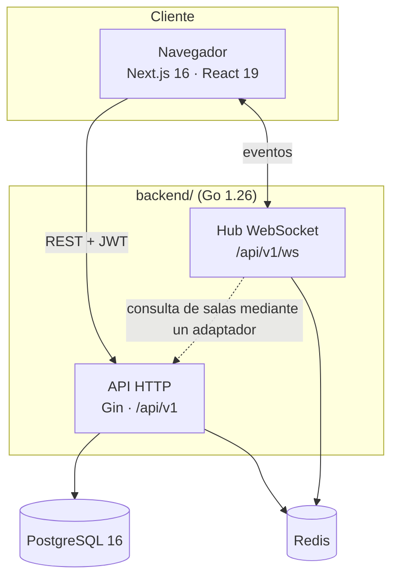
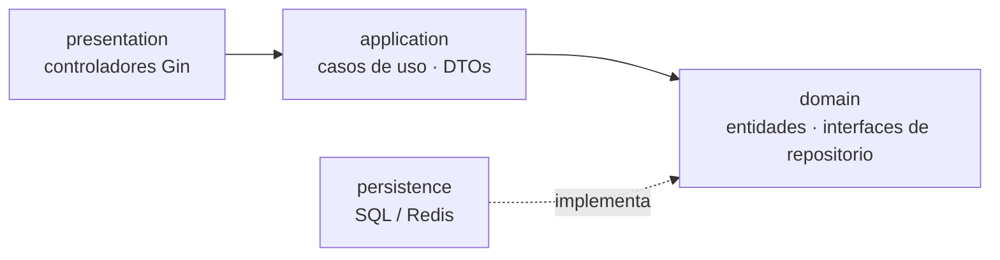
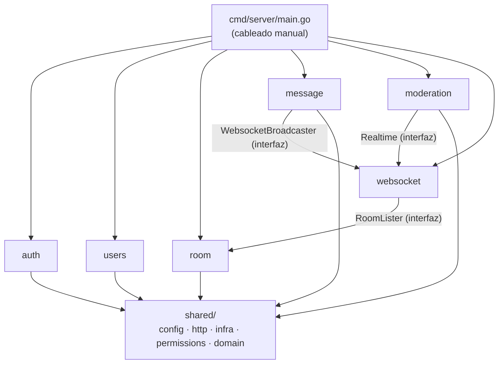
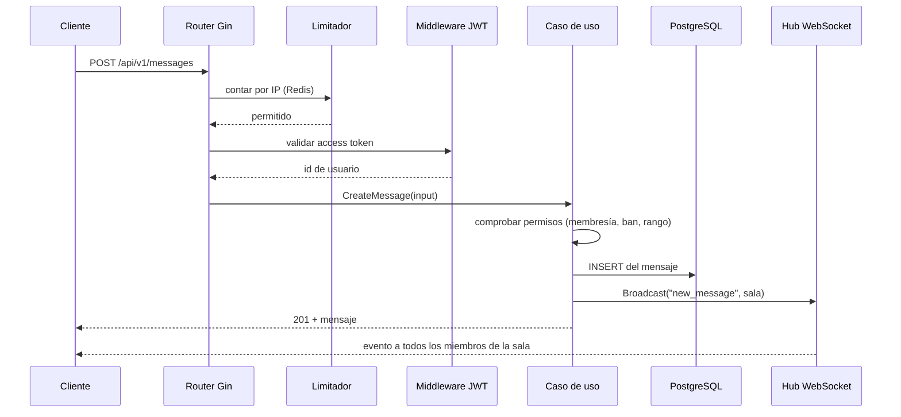
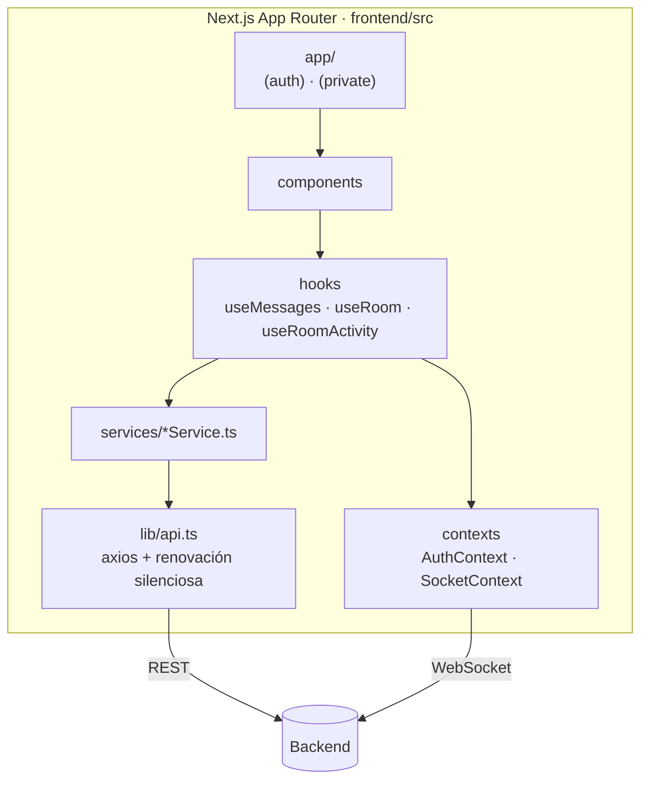
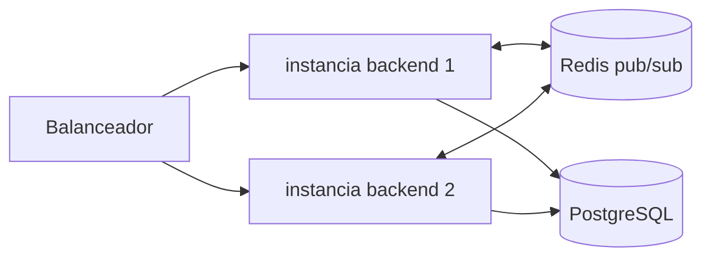

[English](../en/architecture.md) · **🌐 Español**

# Arquitectura

## 1. Contexto del sistema

WebChat es un **monolito modular** con dos aplicaciones desplegables de forma independiente en un mismo repositorio.

| Pieza | Responsabilidad | Puerto (host) |
|---|---|---|
| Frontend | Interfaz, estado de sesión, actualizaciones en vivo | 3100 |
| Backend | API REST, hub WebSocket, migraciones al arrancar | 8081 |
| PostgreSQL | Datos duraderos: usuarios, salas, mensajes, auditoría | 5433 |
| Redis | Estado efímero: ids de refresh token, tickets WS, presencia, contadores de límite, bus de eventos entre instancias | 6380 |

## 2. Backend: Clean Architecture, un paquete por módulo

Cada módulo de negocio bajo `backend/internal/` tiene las mismas cuatro capas. Las dependencias apuntan **solo hacia dentro**: presentation → application → domain, y persistence implementa las interfaces que declara el dominio.

Módulos: `auth`, `users`, `room`, `message`, `moderation`, más `websocket` y `shared`.

`shared/` contiene el código transversal: `config`, `http` (servidor, middleware JWT, limitador de peticiones, health), `infra` (base de datos, Redis, servicios de JWT y correo), `permissions` (la matriz de autorización) y `domain` (errores compartidos, tipos de transacción).

### Cableado

`cmd/server/main.go` construye la configuración, el pool de base de datos, el cliente de Redis, los servicios y los repositorios, y luego llama al `RegisterModule(...)` de cada módulo, que construye los casos de uso y el controlador del módulo y registra sus rutas. Añadir una dependencia implica pasarla por `main.go` y por la firma de `RegisterModule` del módulo.

### Transacciones

Los casos de uso que deben modificar varias tablas de forma atómica pasan por `Store` (`shared/infra/db/sql_store.go`), que envuelve una función en una transacción de base de datos. Los controladores nunca tocan la base de datos.

## 3. Ciclo de vida de una petición

## 4. Frontend

Más detalle en [Frontend](frontend.md).

## 5. Topología de despliegue

Cualquier número de instancias puede atender la misma sala porque los eventos viajan por Redis. Ver [Tiempo real](realtime.md). La automatización del despliegue (imágenes, entornos, copias de seguridad) queda fuera del alcance de esta documentación.

## 6. Configuración

`config.NewConfig` lee variables de entorno y, opcionalmente, precarga el archivo indicado en `CONFIG_FILE`. Se exige `DATABASE_URL` (o `DB_USER`/`DB_HOST`/`DB_PORT`/`DB_NAME`) y `REDIS_URL` también puede armarse con las partes `REDIS_*`. El servidor se niega a arrancar sin `JWT_SECRET`. Las plantillas versionadas son `backend/.env.example` y `frontend/.env.example`; los archivos de entorno reales están ignorados por git.
