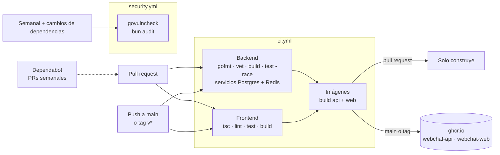

**🌐 [English](../en/ci-cd.md)** · Español

# CI/CD e imágenes de contenedor

Cómo un cambio se convierte en un artefacto verificado y versionado que puede correr en cualquier sitio (hoy un portátil o una VM, más adelante AWS). Nada de esto depende de una nube concreta: lo que se entrega es un par de imágenes de contenedor.

## 1. El pipeline



| Workflow | Cuándo corre | Qué garantiza |
|---|---|---|
| `ci.yml` · backend | cada push y pull request | formato, `go vet`, compilación, todos los tests con detector de carreras, y que **todas las migraciones se aplican sobre un PostgreSQL vacío** (en local el test se omite salvo que `TEST_DATABASE_URL` apunte a una base vacía) |
| `ci.yml` · frontend | igual | tipos, lint, tests, build de producción |
| `ci.yml` · imágenes | cuando pasan los dos anteriores | ambos Dockerfile construyen; en `main` y en tags `v*` además se publican las imágenes |
| `security.yml` | semanal, y cuando cambian los archivos de dependencias | ninguna vulnerabilidad de Go alcanzable (`govulncheck`) y ningún aviso grave de JavaScript (`bun audit`) |
| Dependabot | semanal | pull requests para Go, JavaScript, imágenes base de Docker y las propias acciones de los workflows |

## 2. Las imágenes

| Imagen | Base | Tamaño | Notas |
|---|---|---|---|
| `ghcr.io/<owner>/webchat-api` | `distroless/static`, no root | ≈ 40 MB | binario Go estático; sin shell ni gestor de paquetes |
| `ghcr.io/<owner>/webchat-web` | `node:22-alpine`, no root | ≈ 315 MB | salida `standalone` de Next.js; escucha en el 3100 |

Etiquetas: `sha-<commit>` en cada build de `main`, `main` y `latest` para la punta de la rama, y `1.2.3` para un tag `v1.2.3`. Las imágenes publicadas son **multiarquitectura** (`amd64` y `arm64`), así que corren en hosts x86 normales y en ARM como AWS Graviton.

El lockfile del frontend (`frontend/bun.lock`) está versionado: el CI y la imagen instalan exactamente las versiones que probaste (`--frozen-lockfile`).

Constrúyelas tú mismo:

```bash
docker build -t webchat-api backend
docker build -t webchat-web --build-arg NEXT_PUBLIC_API_URL=https://api.example.com/api/v1 frontend
```

## 3. Decisiones detrás

Ver **D19** en [Decisiones de diseño](decisions.md). En resumen:

- **Lo que se entrega son imágenes.** Cualquier plataforma (ECS, EKS, una VM con Docker, Kubernetes) puede ejecutar una imagen; unos scripts atados a un proveedor no se pueden mover.
- **Primero GHCR.** No necesita credenciales extra (basta el token del propio workflow), así que el pipeline funciona desde el primer día. Pasar a Amazon ECR después solo cambia los pasos de login y de etiquetas.
- **Una imagen web por entorno.** Next.js incrusta los valores `NEXT_PUBLIC_*` en el paquete del navegador al construir, así que la URL de la API es un argumento de build (define la variable del repositorio `NEXT_PUBLIC_API_URL`). La alternativa, leerla en tiempo de ejecución, exigiría un endpoint de configuración o un script de arranque; es fácil de añadir si aparecen más entornos.
- **Las comprobaciones de seguridad van aparte y no bloquean PRs ajenos.** Un aviso nuevo en una dependencia aparece sin que nadie toque el código; debe dar una alarma visible, no frenar un arreglo que no tiene que ver.

## 4. Preparándose para AWS

Esta sección deja por escrito lo que la aplicación ya ofrece y lo que sigue siendo una decisión, para que nadie dé por hecha una función que no existe. Nada de lo siguiente está implementado en el repositorio.

**Ya es cierto**

| Propiedad | Por qué importa en la nube |
|---|---|
| Backend sin estado, el estado vive en PostgreSQL y Redis | puedes correr varias copias detrás de un balanceador; escalar y reemplazar libremente |
| Configuración solo por variables de entorno | encaja con definiciones de tarea, almacenes de parámetros y gestores de secretos sin tocar código |
| `GET /health` y `GET /ready` | destinos listos para las comprobaciones de salud del balanceador y del orquestador |
| Eventos WebSocket retransmitidos por Redis | cualquier instancia atiende cualquier sala, no hacen falta sesiones pegajosas |
| Latido cada ~54 s | queda por debajo del tiempo de inactividad de 60 s por defecto de un balanceador de AWS, así que las conexiones no se cortan |
| Las migraciones corren al arrancar bajo un bloqueo de la base | varias instancias pueden arrancar a la vez sin corromper el esquema |
| Imágenes mínimas, no root, multiarquitectura | menor superficie de ataque; las instancias ARM, más baratas, son una opción |

**Decisiones para más adelante**

| Tema | Notas |
|---|---|
| Registro | Amazon ECR en lugar de GHCR: autentica el workflow con un **rol OIDC** (`aws-actions/configure-aws-credentials`) en vez de claves de acceso guardadas |
| Dónde corre | ECS en Fargate, EKS o EC2: todos consumen las mismas imágenes |
| Base de datos y Redis | RDS para PostgreSQL y ElastiCache. Los refresh tokens viven en Redis: activa la persistencia o asume que perderlo cierra la sesión a todos |
| Secretos | `JWT_SECRET` y las credenciales de base de datos y SMTP van en un gestor de secretos, no en imágenes ni en archivos compose (hallazgo H-051) |
| Dominios y cookies | La cookie de refresh es `SameSite=Strict`: sirve la web y la API desde el mismo dominio registrable (por ejemplo `app.example.com` y `api.example.com`) |
| TLS y CORS | `CORS_ALLOWED_ORIGINS` debe listar el origen real de la web; activa las cookies seguras en producción |
| Observabilidad | métricas, trazas y alertas siguen pendientes en la fase 5 del roadmap |

## 5. Ajustes únicos del repositorio

No pueden vivir en el código, así que es fácil olvidarlos:

1. **Settings → Actions → General → Workflow permissions:** permite lectura; el job de imágenes pide `packages: write` por sí mismo.
2. **Settings → Secrets and variables → Actions → Variables:** añade `NEXT_PUBLIC_API_URL` (sin ella la imagen web apunta a `http://localhost:8081/api/v1`).
3. **Settings → Branches:** exige los checks `Backend (Go)`, `Frontend (Next.js)` y los de imágenes antes de fusionar en `main`.
4. Tras la primera publicación, define la visibilidad de cada paquete en **Packages**.

## 6. Ejecuta las mismas comprobaciones en local

```bash
# backend/ (el test de migraciones necesita una base VACÍA; esta es desechable)
docker run -d --rm --name ci-db -e POSTGRES_PASSWORD=ci -e POSTGRES_DB=ci -p 127.0.0.1:55432:5432 postgres:16-alpine
TEST_DATABASE_URL='postgres://postgres:ci@127.0.0.1:55432/ci?sslmode=disable' go test -race ./...
go run golang.org/x/vuln/cmd/govulncheck@v1.1.4 ./...

# frontend/
bun run lint && bun run test && bun audit --audit-level=high
```
