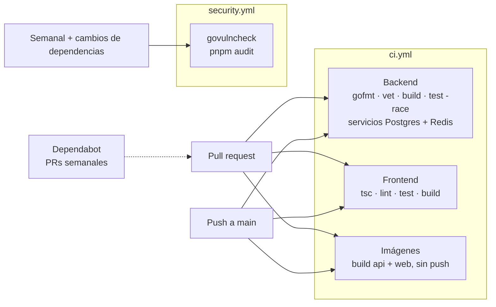

**🌐 [English](../en/ci-cd.md)** · Español

# CI/CD e imágenes de contenedor

Cómo se verifica un cambio antes de llegar a `main` y cómo se construyen las imágenes de contenedor. Nada de esto depende de una nube concreta y nada se publica: el CI solo comprueba que las imágenes construyen.

## 1. El pipeline



| Workflow | Cuándo corre | Qué garantiza |
|---|---|---|
| `ci.yml` · backend | cada push y pull request | formato, `go vet`, compilación, todos los tests con detector de carreras, que **todas las migraciones se aplican sobre un PostgreSQL vacío** y los tests de presencia con Redis (en local ambos se omiten salvo que `TEST_DATABASE_URL` / `TEST_REDIS_ADDR` estén definidas) |
| `ci.yml` · frontend | igual | tipos, lint, tests, build de producción |
| `ci.yml` · imágenes | cada push y pull request | ambos Dockerfile construyen (no se publica nada) |
| `security.yml` | semanal, y cuando cambian los archivos de dependencias | ninguna vulnerabilidad de Go alcanzable (`govulncheck`) y ningún aviso grave de JavaScript (`pnpm audit`) |
| Dependabot | semanal, agrupado, 7 días de espera | pull requests para Go, JavaScript, imágenes base de los Dockerfile, `docker-compose.yml` y las propias acciones de los workflows (un PR agrupado por ecosistema para minor/patch) |

## 2. Las imágenes

| Imagen | Base | Tamaño | Notas |
|---|---|---|---|
| `webchat-api` | `distroless/static`, no root | ≈ 40 MB | binario Go estático; sin shell ni gestor de paquetes |
| `webchat-web` | `node:24-alpine`, no root | ≈ 315 MB | salida `standalone` de Next.js; escucha en el 3100 |

El lockfile del frontend (`frontend/pnpm-lock.yaml`) está versionado: el CI y la imagen instalan exactamente las versiones que probaste (`--frozen-lockfile`).

Constrúyelas tú mismo:

```bash
docker build -t webchat-api backend
docker build -t webchat-web --build-arg NEXT_PUBLIC_API_URL=https://api.example.com/api/v1 frontend
```

## 3. Decisiones detrás

Ver **D19** en [Decisiones de diseño](decisions.md). En resumen:

- **La imagen es la unidad ejecutable.** Cualquier plataforma (ECS, EKS, una VM con Docker, Kubernetes) puede ejecutar una imagen; unos scripts atados a un proveedor no se pueden mover.
- **El CI construye, no publica.** Construir en cada ejecución detecta un Dockerfile roto antes de fusionar; dónde y cómo se guardan y despliegan las imágenes lo decide quien despliega.
- **Una imagen web por entorno.** Next.js incrusta los valores `NEXT_PUBLIC_*` en el paquete del navegador al construir, así que la URL de la API es un argumento de build (define la variable del repositorio `NEXT_PUBLIC_API_URL`). La alternativa, leerla en tiempo de ejecución, exigiría un endpoint de configuración o un script de arranque; es fácil de añadir si aparecen más entornos.
- **Las comprobaciones de seguridad van aparte y no bloquean PRs ajenos.** Un aviso nuevo en una dependencia aparece sin que nadie toque el código; debe dar una alarma visible, no frenar un arreglo que no tiene que ver.

### Fijado de versiones y actualizaciones (D28)

- Las acciones se fijan con el SHA completo del commit y la versión en un comentario; Dependabot actualiza ambos.
- Las bases de los Dockerfile (`golang`, `distroless/static-debian13`) se fijan por etiqueta **y digest**; Dependabot renueva el digest. Las imágenes de Postgres (16) y Redis (8) en compose, CI y `make test-integration` llevan solo la etiqueta de la versión mayor, y Dependabot nunca propone sus mayores (un cambio mayor es una migración de datos).
- Pasar a un nuevo minor de Go es manual y toca cuatro sitios a la vez: la directiva `go` de `backend/go.mod` (con el parche), la etiqueta y el digest de `golang` en `backend/Dockerfile`, la versión en la documentación, y leer las notas de la versión. `govulncheck` en `security.yml` se fija a mano (Dependabot no lo ve).

## 4. Preparándose para AWS

Esta sección deja por escrito lo que la aplicación ya ofrece y lo que sigue siendo una decisión, para que nadie dé por hecha una función que no existe. Nada de lo siguiente está implementado en el repositorio.

**Ya es cierto**

| Propiedad | Por qué importa en la nube |
|---|---|
| Backend sin estado, el estado vive en PostgreSQL y Redis | puedes correr varias copias detrás de un balanceador; escalar y reemplazar libremente |
| Configuración solo por variables de entorno | encaja con definiciones de tarea, almacenes de parámetros y gestores de secretos sin tocar código |
| `GET /health` y `GET /ready` | destinos listos para las comprobaciones de salud del balanceador y del orquestador |
| Eventos WebSocket retransmitidos por Redis | cualquier instancia atiende cualquier sala, no hacen falta sesiones pegajosas |
| Latido cada ~54 s | queda por debajo del tiempo de inactividad de 60 s por defecto de un balanceador de AWS, así que las conexiones no se cortan |
| Las migraciones corren al arrancar bajo un bloqueo de la base | varias instancias pueden arrancar a la vez sin corromper el esquema |
| Imágenes mínimas y no root | menor superficie de ataque |

**Decisiones para más adelante**

| Tema | Notas |
|---|---|
| Registro y publicación | no configurados; si se añaden, autentica el workflow con un **rol OIDC** (`aws-actions/configure-aws-credentials`) en vez de claves de acceso guardadas |
| Dónde corre | ECS en Fargate, EKS o EC2: todos consumen las mismas imágenes |
| Base de datos y Redis | RDS para PostgreSQL y ElastiCache. Los refresh tokens viven en Redis: activa la persistencia o asume que perderlo cierra la sesión a todos |
| Secretos | `JWT_SECRET` y las credenciales de base de datos y SMTP van en un gestor de secretos, no en imágenes ni en archivos compose (hallazgo H-051) |
| Dominios y cookies | La cookie de refresh es `SameSite=Strict`: sirve la web y la API desde el mismo dominio registrable (por ejemplo `app.example.com` y `api.example.com`) |
| TLS y CORS | `CORS_ALLOWED_ORIGINS` debe listar el origen real de la web; activa las cookies seguras en producción |
| Observabilidad | métricas, trazas y alertas siguen pendientes en la fase 5 del roadmap |

## 5. Ajustes únicos del repositorio

No pueden vivir en el código, así que es fácil olvidarlos:

1. **Settings → Secrets and variables → Actions → Variables:** añade `NEXT_PUBLIC_API_URL` (sin ella la imagen web se construye apuntando a `http://localhost:8081/api/v1`).
2. **Settings → Branches:** exige los checks `Backend (Go)`, `Frontend (Next.js)` y los de imágenes antes de fusionar en `main`.

## 6. Ejecuta las mismas comprobaciones en local

```bash
# backend/ (el test de migraciones necesita una base VACÍA; esta es desechable)
docker run -d --rm --name ci-db -e POSTGRES_PASSWORD=ci -e POSTGRES_DB=ci -p 127.0.0.1:55432:5432 postgres:16-alpine
docker run -d --rm --name ci-redis -p 127.0.0.1:56379:6379 redis:8-alpine
TEST_REDIS_ADDR=127.0.0.1:56379 TEST_DATABASE_URL='postgres://postgres:ci@127.0.0.1:55432/ci?sslmode=disable' go test -race ./...
go run golang.org/x/vuln/cmd/govulncheck@v1.9.0 ./...

# frontend/
pnpm run lint && pnpm run test && pnpm audit --audit-level=high
```
