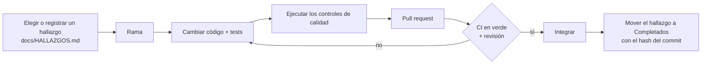
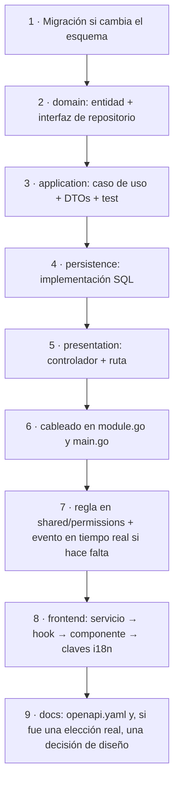

[English](../en/contributing.md) · **🌐 Español**

# Contribuir

Gracias por ayudar. Esta página es el camino más corto de una idea a un cambio integrado.

## 1. Flujo de trabajo



El trabajo se sigue en [HALLAZGOS.md](../HALLAZGOS.md) (incidencias abiertas) y [ROADMAP.md](../ROADMAP.md) (fases). Al resolver un hallazgo, muévelo a **Completados** con el hash del commit.

## 2. Controles de calidad (los mismos que ejecuta la CI)

```bash
# backend/
gofmt -l .            # no debe imprimir nada
go vet ./...
go build ./...
go test -race ./...

# frontend/
bunx tsc --noEmit
bun run lint
bun run test
bun run build
```

## 3. Reglas que mantienen sano el código

| Área | Regla | Por qué |
|---|---|---|
| Autorización | Toda comprobación de permisos pasa por `internal/shared/permissions` | Un único lugar que auditar; sin comparaciones de rol ad hoc |
| Base de datos | Nunca edites una migración ya aplicada; añade un par `.up.sql` / `.down.sql` numerado | Todos los entornos convergen en un solo esquema |
| Capas | `domain` no sabe nada de Gin, SQL ni Redis; los controladores llaman a casos de uso, no a repositorios | Reglas de negocio testeables |
| Módulos | El acceso entre módulos va por interfaces pequeñas cableadas en `main.go` | Sin ciclos de importación; módulos extraíbles |
| Contrato de la API | Todo cambio en una ruta, petición o respuesta actualiza `backend/api/openapi.yaml` en el mismo commit (`go test ./api/` vigila su coherencia) | `/docs` siempre coincide con el servidor |
| Configuración | Variable nueva ⇒ añádela también a `backend/.env.example` | La plantilla es la fuente de verdad |
| Secretos | Nunca leas, pegues ni subas archivos `.env*`, claves o tokens | Se mantienen fuera del historial |
| Textos de UI | Nada de textos fijos: añade la clave a `en.ts` **y** `es.ts` y usa `t()` | Ambos idiomas siguen completos |
| Colores de UI | Usa tokens semánticos de Tailwind, nunca colores fijos | El modo oscuro sigue funcionando |
| Tests | Caso de uso nuevo ⇒ test unitario con dobles; helper puro nuevo ⇒ test de Vitest | La suite es la red de seguridad |

## 4. Añadir una funcionalidad: un recorrido



## 5. Commits y pull requests

- Commits pequeños y enfocados, con asunto en imperativo (`Add ban expiry to bans`).
- Explica el **porqué** en el cuerpo cuando no sea evidente.
- Un pull request debe decir qué cambió, cómo lo verificaste y enlazar el hallazgo que resuelve.

## 6. Documentación

La documentación vive en `docs/en/` y `docs/es/` con nombres de archivo idénticos. **Cambia ambos idiomas en el mismo pull request** y conserva el selector de idioma en la primera línea de cada página. Los diagramas usan [Mermaid](https://mermaid.js.org/), que GitHub renderiza directamente. Cuando tomes una decisión que alguien cuestionará más adelante, añade una entrada a `decisions.md`.

## 7. Reportar problemas de seguridad

No abras una incidencia pública. Ver [Seguridad](security.md#8-cómo-reportar-una-vulnerabilidad).
