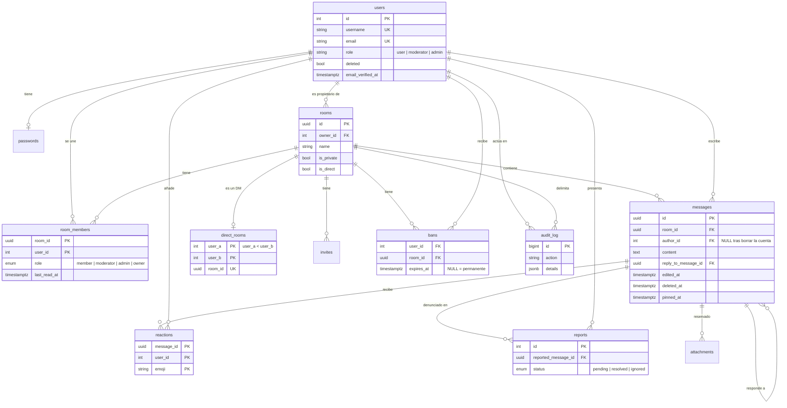

[English](../en/data-model.md) · **🌐 Español**

# Modelo de datos

PostgreSQL 16. El esquema lo definen los archivos de `backend/migrations/` y se aplica al arrancar.

## Notas de diseño

| Tema | Decisión |
|---|---|
| Identificadores | `users` usa enteros seriales; `rooms`, `messages` y `attachments` usan UUID para poder crearse y referenciarse desde el cliente sin revelar cantidades |
| Borrado | `messages.deleted_at` es un borrado lógico. `author_id` es `ON DELETE SET NULL`, lo que convierte una cuenta borrada en "usuario eliminado" |
| Contadores de no leídos | `room_members.last_read_at`; el contador es el número de mensajes más nuevos en esa sala |
| Mensajes directos | Una sala normal con `is_direct`, más `direct_rooms`, que garantiza una por pareja (`CHECK (user_a < user_b)`) |
| Mensajes fijados | `pinned_at` más un índice parcial que solo cubre las filas fijadas |
| Búsqueda | Índice GIN de texto completo sobre `messages.content`, sin distinguir acentos |
| Rol global | `users.role` con un `CHECK`, modificado solo por `cmd/admin` |
| Refresh tokens | Sus ids viven en Redis. La tabla `refresh_tokens` de la primera migración existe pero no se usa |
| Adjuntos | La tabla está reservada para la futura función de adjuntos; por ahora nada escribe en ella |

## Índices principales

| Índice | Para qué sirve |
|---|---|
| `messages (room_id, created_at DESC)` | paginación del historial |
| `messages (room_id, pinned_at DESC) WHERE pinned_at IS NOT NULL` | lista de fijados |
| `messages USING GIN (to_tsvector('simple', content))` | búsqueda |
| `invites (room_id, expires_at)` | invitaciones vigentes |
| `audit_log (room_id, created_at DESC)` | auditoría por sala |

## Historial de migraciones

| # | Cambio |
|---|---|
| 1 | Esquema inicial |
| 2 | Seguimiento de no leídos (`last_read_at`) |
| 3 | Mensajes fijados |
| 4 | Mensajes directos |
| 5–6 | Búsqueda de texto completo, luego sin distinguir acentos |
| 7 | Rol de sala `moderator` |
| 8 | Roles globales y `audit_log` |
| 9 | Una denuncia por persona y mensaje |
| 10 | Soporte para borrar la cuenta |

Regla: nunca se edita una migración ya aplicada. Se añade un nuevo par numerado de archivos `.up.sql` y `.down.sql`.
