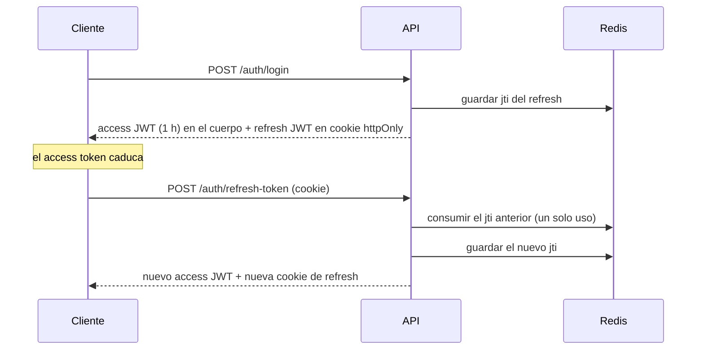
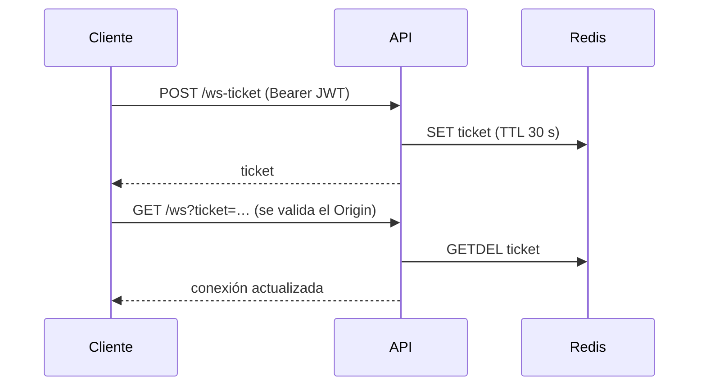

[English](../en/decisions.md) · **🌐 Español**

# Decisiones de diseño

Cada entrada recoge el **contexto**, la **decisión**, las **alternativas** que se evaluaron y las **consecuencias** que aceptamos. Cuando una decisión cambia, se añade una entrada nueva en lugar de reescribir la historia.

| # | Decisión | Estado |
|---|---|---|
| D1 | Monolito modular con Clean Architecture | Aceptada |
| D2 | Go + Gin para el backend | Aceptada |
| D3 | PostgreSQL como fuente de verdad, Redis para estado efímero | Aceptada |
| D4 | Migraciones SQL versionadas (golang-migrate), aplicadas al arrancar | Aceptada |
| D5 | Access JWT corto + refresh token rotativo en cookie httpOnly | Aceptada |
| D6 | El access token solo en memoria en el cliente | Aceptada |
| D7 | WebSocket autenticado con un ticket de un solo uso | Aceptada |
| D8 | Redis pub/sub como bus de eventos entre instancias | Aceptada |
| D9 | Una única matriz de permisos basada en rangos | Aceptada |
| D10 | Los mensajes directos son salas privadas | Aceptada |
| D11 | Paginación por cursor | Aceptada |
| D12 | Búsqueda de texto completo dentro de PostgreSQL | Aceptada |
| D13 | Borrado lógico de mensajes, anonimización de cuentas | Aceptada |
| D14 | Roles globales otorgados solo mediante una CLI | Aceptada |
| D15 | i18n sin dependencias y temas con variables CSS | Aceptada |
| D16 | Envío optimista con estados explícitos | Aceptada |
| D17 | Dirección visual "Foco" | Aceptada |
| D18 | Directorio de personas, salas descubribles e invitaciones personales | Aceptada |
| D19 | Imágenes de contenedor construidas en el CI, sin publicar; CI/CD neutral a la nube | Aceptada |
| D20 | Sesiones persistentes con ventana deslizante de 7 días | Aceptada |
| D21 | Restablecer contraseña con enlace de un solo uso por correo | Aceptada |
| D22 | pnpm como gestor de paquetes del frontend | Aceptada |
| D23 | Tokens con tipo y validación de sesión en cada petición | Aceptada |
| D24 | Presencia por usuario y hub acotado | Aceptada |
| D25 | Cabeceras de seguridad y CSP en la aplicación web | Aceptada |
| D26 | Patrones de accesibilidad: anuncios en vivo, diálogos propios, manejo del foco | Aceptada |
| D27 | Límites del servidor y apagado ordenado | Aceptada |

---

## D1. Monolito modular con Clean Architecture

- **Contexto:** un equipo pequeño, un único producto desplegable, pero un dominio (auth, salas, mensajes, moderación) que seguirá creciendo.
- **Decisión:** un solo proceso Go con un paquete por módulo; cada módulo tiene capas `domain`, `application`, `persistence` y `presentation`. Los módulos se comunican mediante interfaces pequeñas (por ejemplo `WebsocketBroadcaster`, `RoomLister`), nunca importando los paquetes de otro módulo.
- **Alternativas:** microservicios (coste operativo sin beneficio a este tamaño); una estructura plana de "handlers + modelos" (rápida al inicio, pero las reglas de negocio se filtran al código HTTP y dejan de ser testeables).
- **Consecuencias:** los casos de uso se prueban con dobles y sin base de datos. Las interfaces cuestan algo de código repetitivo y el cableado es manual en `main.go`. Si algún módulo hay que extraerlo, las costuras ya existen.

## D2. Go + Gin

- **Contexto:** un servicio dominado por muchas conexiones concurrentes, casi siempre inactivas.
- **Decisión:** Go por sus goroutines baratas y un binario estático único; Gin para rutas y middleware.
- **Alternativas:** Node.js (comparte lenguaje con el frontend, pero el trabajo intensivo de CPU y la memoria por conexión escalan peor); un framework más pesado (más funciones que no necesitamos).
- **Consecuencias:** frontend y backend no comparten tipos, así que los contratos de la API se mantienen a mano (un contrato OpenAPI está en el roadmap).

## D3. PostgreSQL como fuente de verdad, Redis para estado efímero

- **Decisión:** todo lo que debe sobrevivir a un reinicio vive en PostgreSQL. Todo lo que tiene TTL o se comparte entre instancias vive en Redis: ids de refresh token, tickets WebSocket, presencia, contadores de límite y el bus de eventos.
- **Alternativas:** guardar la presencia en el proceso (se rompe con más de una instancia); guardar las sesiones en PostgreSQL (más escrituras para datos que están pensados para caducar).
- **Consecuencias:** dos dependencias con estado que operar. El limitador **falla abierto**: si Redis cae, se permiten las peticiones y se registra el problema, porque aquí pesa más la disponibilidad que la rigurosidad.

## D4. Migraciones SQL versionadas

- **Contexto:** la primera versión creaba las tablas a mano desde un `schema.sql`.
- **Decisión:** archivos de golang-migrate (`NNNNNN_nombre.up.sql` / `.down.sql`) embebidos en el binario y aplicados al arrancar. Una base creada a mano se adopta en la versión 1.
- **Reglas:** nunca se edita una migración ya aplicada; se añade un nuevo par numerado.
- **Consecuencias:** un clon limpio, la CI y producción convergen en el mismo esquema. Arrancar una instancia nueva puede ejecutar migraciones un instante, aceptable a esta escala.

## D5. Access JWT corto + refresh token rotativo

- **Decisión:** un access token de 1 hora devuelto en el cuerpo, y un refresh token de 7 días cuyo id (`jti`) se guarda en Redis y se puede usar **una sola vez**. Al usarlo se emite un par nuevo.
- **Por qué rotar:** un refresh token robado deja de servir en cuanto el cliente legítimo renueva, y uno reutilizado es detectable. `POST /auth/logout` revoca el id vigente.
- **Alternativas:** access tokens de larga duración (una filtración vale días); sesiones en servidor (revocación más simple, pero exige estado en cada petición).

## D6. El access token solo en memoria en el cliente

- **Decisión:** el navegador guarda el access token en una variable de JavaScript (`lib/tokenStorage.ts`), nunca en `localStorage`. El refresh token es una cookie httpOnly, `SameSite=Strict` y limitada a `/api/v1/auth`. Al recargar, `AuthContext` restaura la sesión llamando a refresh.
- **Por qué:** cualquier XSS puede leer `localStorage`; no puede leer una cookie httpOnly, y el token en memoria desaparece con la página.
- **Consecuencias:** una petición extra al cargar la página, y el interceptor de axios debe renovar de forma transparente ante un `401`.

## D7. WebSocket autenticado con un ticket de un solo uso

- **Contexto:** los navegadores no pueden enviar la cabecera `Authorization` en un WebSocket, así que el token terminaría en la URL, donde lo registran proxies y logs.
- **Decisión:** canjear el JWT por un ticket de 30 segundos y un solo uso. El servidor además valida la cabecera `Origin` contra `CORS_ALLOWED_ORIGINS`.
- **Consecuencias:** una URL filtrada no sirve pasados unos segundos y no se puede reutilizar.

## D8. Redis pub/sub como bus de eventos

- **Decisión:** el hub publica cada evento en un canal de Redis; cada instancia lo entrega a sus propios clientes conectados. La presencia es un sorted set de Redis compartido por todas las instancias.
- **Alternativas:** sesiones pegajosas (carga desigual y, aun así, los miembros de una sala pueden estar en instancias distintas); Kafka/NATS (más infraestructura de la que el problema necesita).
- **Consecuencias:** la entrega es como máximo una vez. Los clientes reconectan con backoff y recargan el historial reciente para recuperar lo perdido.

## D9. Una única matriz de permisos basada en rangos

- **Contexto:** moderación, fijado, invitaciones y borrado tenían cada uno su propia comparación de roles, que es donde se esconden los errores de autorización.
- **Decisión:** `internal/shared/permissions` es el único lugar que decide quién puede hacer qué. Los roles de sala (`member < moderator < admin < owner`) y los globales se convierten en un rango numérico, y las reglas dicen "quien actúa debe **superar estrictamente** al objetivo".
- **Regla para quien contribuye:** las comprobaciones nuevas pasan por ese paquete, nunca por comparaciones de texto ad hoc. El frontend replica la matriz en `lib/permissions.ts` solo para decidir qué *mostrar*; el servidor siempre decide.

## D10. Los mensajes directos son salas privadas

- **Decisión:** un chat 1 a 1 es una sala privada con `is_direct = true`, una por pareja de usuarios (`direct_rooms`, con `user_a < user_b` forzado por un `CHECK`).
- **Por qué:** historial, contadores de no leídos, búsqueda, reacciones, presencia y entrega por WebSocket funcionan **sin código nuevo**.
- **Consecuencias:** algunas funciones se bifurcan según `is_direct` (sin lista de miembros, sin denuncias).

## D11. Paginación por cursor

- **Decisión:** el historial se pagina por cursor (`?limit=&before=`) sobre `(room_id, created_at DESC)`.
- **Alternativas:** la paginación con `OFFSET` salta o repite filas cuando llegan mensajes nuevos y se vuelve más lenta con la profundidad.

## D12. Búsqueda de texto completo dentro de PostgreSQL

- **Decisión:** un índice GIN sobre `to_tsvector('simple', content)` con coincidencia sin distinguir acentos (`unaccent`), limitado a las salas a las que pertenece el usuario.
- **Alternativas:** Elasticsearch/Meilisearch ofrecen mejor ordenación pero añaden un servicio que operar y sincronizar. Se revisará si la búsqueda pasa a ser una función central.

## D13. Borrado lógico de mensajes, anonimización de cuentas

- **Decisión:** borrar un mensaje fija `deleted_at`, de modo que hilos, denuncias y auditoría siguen siendo coherentes. Borrar una cuenta traspasa las salas propias a otro miembro (o las elimina si el propietario está solo) y conserva los mensajes mostrados como "usuario eliminado" (`author_id` pasa a `NULL`).
- **Por qué:** respeta el derecho de una persona a borrar sus datos sin romper las conversaciones de los demás. `GET /users/export` ofrece la exportación de datos correspondiente.

## D14. Roles globales solo mediante una CLI

- **Decisión:** `users.role` (`user | moderator | admin`) nunca se puede escribir por la API HTTP. Se otorga con `cmd/admin` (`make admin-grant`).
- **Por qué:** no hay endpoint que atacar para escalar privilegios; quien pueda llegar a la base de datos decide quién es admin.

## D15. i18n sin dependencias y temas con variables CSS

- **Decisión:** diccionarios tipados (`en.ts` es la fuente de verdad de las claves y `es.ts` debe cumplir el mismo tipo) y un hook `useT()`; temas claro y oscuro mediante variables CSS y tokens semánticos de Tailwind.
- **Por qué:** la app tiene dos idiomas y unos cientos de textos, lo que no justifica un framework de i18n ligado al enrutado. Una traducción que falta es un error de compilación, y un test comprueba que los placeholders coinciden en ambos idiomas.
- **Consecuencias:** el idioma se elige en el cliente, así que el HTML renderizado en el servidor sale en inglés y puede parpadear un instante antes de hidratar. Si aparecen páginas públicas relevantes para SEO, se revisará con rutas con prefijo de idioma.

## D16. Envío optimista con estados explícitos

- **Decisión:** el mensaje aparece al instante como *enviando* y, si falla, pasa a *no enviado* con **Reintentar** y **Descartar**.
- **Por qué:** las redes inestables son normales en móvil; ocultar los fallos pierde mensajes en silencio.

## D17. Dirección visual "Foco"

- **Contexto:** la primera interfaz era un marcador neutro. Se prototiparon tres direcciones con el mismo contenido (chat de escritorio, móvil y acceso): **Foco** (densa, herramienta de equipo), **Calidez** (redondeada, burbujas, comunidad) y **Redacción** (editorial, serif, monocroma).
- **Decisión:** Foco. Tarjetas de mensaje con borde, con autor y rol, lista de salas a la izquierda con prefijos `#`, panel lateral de miembros y un único acento índigo.
- **Por qué:** el centro del producto son las salas, los roles y la moderación, que necesitan densidad de información y etiquetas de rol claras más que personalidad. Las tarjetas muestran autor, rol y hora de forma compacta, y un solo acento mantiene sin ambigüedad los contadores de no leídos y la selección en ambos temas.
- **Alternativas:** Calidez ofrece el móvil más amable pero gasta ancho en burbujas; Redacción es la más distintiva pero es más difícil de mantener coherente según crecen las funciones.
- **Consecuencias:** todo el color sale de tokens semánticos (`primary`, `soft`, `success`...), así que la dirección puede reajustarse en un solo archivo (`globals.css`).

## D18. Directorio de personas, salas descubribles e invitaciones personales

- **Contexto:** hasta ahora solo podías llegar a alguien por una sala compartida, y la única forma de entrar en una sala privada era un código anónimo enviado a mano desde la API.
- **Decisión:** tres ideas separadas. (1) *La presencia es global:* un panel de personas siempre visible lista a todos con su estado de conexión y puedes escribir a cualquiera (una conversación directa no necesita sala compartida). (2) *Las salas son descubribles:* todas se listan; las públicas se pueden abrir, las privadas se ven pero sus mensajes solo los leen los miembros. (3) *Invitaciones personales:* un propietario o admin invita a una persona concreta; le aparece en su app y, solo al aceptarla, pasa a ser miembro con historial y permiso para escribir.
- **Por qué:** estar en línea, hablar en privado y pertenecer a una sala son preguntas distintas. Mezclarlas (miembros solo visibles dentro de las salas) hacía que la app se sintiera vacía. Mantener la privacidad a nivel de sala protege el contenido privado y aun así anuncia que la sala existe.
- **Alternativas:** ocultar del todo las salas privadas (no habría nada a lo que pedir invitación), o solo códigos de invitación (incómodo y sin destinatario).
- **Consecuencias:** el directorio expone nombres y usuarios a cualquier persona con sesión, algo adecuado para un servidor de equipo; en un despliegue público haría falta un ajuste de visibilidad. Las invitaciones se consultan cada 15 s en lugar de enviarse en vivo.

## D19. Imágenes de contenedor construidas en el CI, sin publicar; CI/CD neutral a la nube

- **Contexto:** el CI solo comprobaba el código. Nada producía un artefacto ejecutable y versionado, el frontend no tenía Dockerfile, las migraciones nunca se habían probado sobre una base vacía y las dependencias nunca se escaneaban.
- **Decisión:** el CI además construye ambas imágenes en cada ejecución para probar que los Dockerfile funcionan, pero no las publica en ningún sitio (una versión anterior subía imágenes multiarquitectura a GHCR desde `main` y los tags; se quitó a petición); un workflow semanal aparte escanea las dependencias; Dependabot lo mantiene al día. El despliegue en sí queda deliberadamente fuera del pipeline.
- **Por qué:** una imagen corre en cualquier plataforma, así que elegir AWS más adelante (u otra cosa) no invalida el trabajo. Construir imágenes en los pull requests detecta un Dockerfile roto antes de fusionar. El primer escaneo encontró problemas reales (avisos críticos de Next.js, una línea de Go sin mantenimiento con 29 vulnerabilidades alcanzables, un driver de base de datos sin uso con una vulnerabilidad sin arreglo), que es el argumento para ejecutarlo de forma continua.
- **Alternativas:** scripts de despliegue para un proveedor (no portables), o publicar en un registro (descartado: no se quiere por ahora; puede volver más adelante con un login autenticado por OIDC).
- **Consecuencias:** la imagen web es por entorno porque Next.js incrusta `NEXT_PUBLIC_*` al construir. El toolchain de Go pasó de 1.24 (ya sin parches) a 1.26, y se eliminó el driver `pgx`, que no se usaba; el real es `lib/pq`. Ver [CI/CD](ci-cd.md).

## D20. Sesiones persistentes con ventana deslizante de 7 días

- **Contexto:** la gente espera volver a la app abierta tras cerrar la pestaña, y que se le pida iniciar sesión de nuevo solo tras una ausencia larga.
- **Decisión:** el refresh token vive 7 días en una cookie httpOnly persistente, y **cada renovación emite un token nuevo con otros 7 días**. Así la sesión termina a los siete días *sin uso*, no siete días después de iniciar sesión. Un token ya usado sigue valiendo 30 segundos más. El navegador cierra la sesión solo cuando el servidor rechaza el token de forma explícita (401/403), nunca porque falló la red.
- **Por qué:** una sesión fija de 7 días echaría a quien usa la app a diario. La gracia de 30 segundos cubre dos pestañas que restauran a la vez y una respuesta perdida en tránsito, que de otro modo parecerían un robo de token y cerrarían la sesión. Tratar un fallo de red como un rechazo acabaría sesiones válidas cada vez que un portátil despierta sin conexión.
- **Alternativas:** una vida fija más larga (echa igualmente a quien está activo y amplía la ventana de robo), o que nunca caduque (un dispositivo perdido queda con sesión para siempre).
- **Consecuencias:** un token usado se puede reutilizar durante 30 segundos, un compromiso deliberado a favor de la fiabilidad. Actividad significa que la app renueve su access token (cada hora aproximadamente mientras se usa); una pestaña abierta y sin tocar no alarga la sesión. Los refresh tokens viven en Redis, así que perderlo sin persistencia cierra la sesión a todos.

## D21. Restablecer contraseña con enlace de un solo uso por correo

- **Contexto:** olvidar la contraseña dejaba la cuenta inaccesible. El servicio de correo ya existía, pero la *verificación* del email está pausada (H-008).
- **Decisión:** `POST /auth/forgot-password` envía un enlace con un token aleatorio válido 30 minutos; `POST /auth/reset-password` lo canjea. El token son bytes aleatorios, no un JWT, y en Redis solo se guarda su hash SHA-256. Canjearlo fija la contraseña con la misma política que el registro, quema el enlace y rechaza todos los refresh tokens emitidos antes de ese momento.
- **Por qué:** el endpoint responde igual exista o no la dirección, si no se convertiría en una forma de listar quién tiene cuenta. Guardar un hash hace que una filtración de Redis no dé enlaces utilizables. Cerrar todas las sesiones importa porque el motivo habitual para cambiar la contraseña es sospechar que otra persona la tiene. Un enfriamiento de un minuto por dirección y un límite por cliente impiden usar el formulario para inundar el correo de alguien.
- **Alternativas:** un enlace con JWT firmado (no se puede revocar ni quemar sin guardar algo igualmente), o preguntas de seguridad (débiles y adivinables).
- **Consecuencias:** necesita ajustes SMTP que funcionen; si el envío falla la persona sigue viendo la confirmación neutra (el error solo se registra). Los access tokens ya emitidos siguen valiendo hasta que caducan, una hora como máximo. Los escáneres de enlaces que precargan URLs son inofensivos porque abrir la página no canjea el token; solo lo hace enviar el formulario.

## D22. pnpm como gestor de paquetes del frontend

- **Contexto:** el gestor de paquetes del frontend era un runtime aparte usado solo para instalar y ejecutar scripts, mientras que la aplicación corre sobre Node (Next.js, el contenedor, Vitest): una cosa más que instalar en local, en el CI y en la imagen.
- **Decisión:** pnpm, fijado con `packageManager` en `package.json` (así Corepack, `pnpm/action-setup` y el Dockerfile usan la misma versión). Lockfile `pnpm-lock.yaml`; el script de instalación de `unrs-resolver` se rechaza de forma explícita (`pnpm-workspace.yaml`), porque trae binarios precompilados. El CI, el escaneo de seguridad y la construcción de la imagen instalan con `--frozen-lockfile` sobre Node 22; Dependabot usa el ecosistema `npm`, que lee los lockfiles de pnpm.
- **Por qué:** un solo runtime (Node) en todas partes, un `node_modules` estricto que revela dependencias no declaradas, un almacén por contenido y `pnpm audit` para el escaneo de seguridad.
- **Consecuencias:** la imagen solo necesita Node. Todos necesitan pnpm en local (`corepack enable` en Node anterior a 25, si no `npm i -g pnpm`).

## D23. Tokens con tipo y validación de sesión en cada petición

- **Contexto:** el JWT de verificación de email compartía secreto con el token de acceso y no llevaba ninguna marca, así que el middleware lo aceptaba como token de acceso; los usuarios desactivados o con sesiones revocadas conservaban acceso a la API hasta que caducaba su token (hasta una hora).
- **Decisión:** cada JWT lleva una claim `typ` (`access`, `refresh`, `verify`) y cada consumidor exige la suya; la firma se fija a HS256. `JWTMiddleware` recibe un `SessionGuard` que rechaza los tokens emitidos antes de `sessions_revoked_at` del usuario (Redis) y los de usuarios desactivados (Postgres, con caché de 15 s); si una dependencia cae, deja pasar y lo registra. Desactivar ahora exige la contraseña, revoca sesiones y desconecta los sockets; restablecer contraseña también desconecta sockets, y el canje del ticket de WebSocket consulta el mismo guardián.
- **Por qué:** el tipo de un token lo debe comprobar su consumidor, no deducirse de la ausencia de otra claim. Los JWT sin estado sirven hasta que hace falta cortar el acceso al instante, y eso lo da una pequeña comprobación por petición a cambio de una lectura de Redis.
- **Consecuencias:** las sesiones abiertas al desplegar reciben un 401 y se refrescan una vez. Los nombres de usuario se limitan a `[A-Za-z0-9_.-]` y email y usuario son únicos sin distinguir mayúsculas (la migración 13 se niega a correr si dos cuentas colisionan, y las lista). El login hace una comparación bcrypt falsa con usuarios desconocidos. El ticket no lleva su hora de emisión, así que uno emitido antes de un restablecimiento aún puede conectar durante sus 30 s.

## D24. Presencia por usuario y hub acotado

- **Contexto:** la presencia vivía en un único conjunto ordenado que se leía entero en cada conexión, desconexión y listado (unos 4 GB de tráfico a Redis en una reconexión masiva de 10 mil usuarios); el hub recorría todas las salas en cada desconexión y mantenía un candado global durante el reparto.
- **Decisión:** un conjunto ordenado por usuario (`webchat:presence:u:<id>`, con la caducidad como puntuación) actualizado con scripts Lua atómicos, más un índice secundario `webchat:presence:online` (un miembro por usuario en línea, leído con LIMIT) para saber quién está conectado. El hub guarda conjuntos de salas por cliente y un índice de usuarios, reparte desde una copia fuera del candado, serializa una sola vez, nunca se bloquea con un canal de difusión lleno (descarta y cuenta) y tiene `Shutdown`, que cierra los sockets con el código 1012.
- **Por qué:** cada decisión toca la clave de un solo usuario, así que el coste no crece con los usuarios conectados, y un consumidor lento o un atasco de Redis no puede congelar los manejadores de peticiones.
- **Consecuencias:** los usuarios de una instancia caída siguen en línea hasta dos minutos (TTL). `OnlineUsers` comprueba como máximo 1000 ids por llamada.

## D25. Cabeceras de seguridad y CSP en la aplicación web

- **Decisión:** `next.config.mjs` fija `X-Frame-Options: DENY`, `nosniff`, `Referrer-Policy: no-referrer` (el token de restablecimiento va en la URL), un `Permissions-Policy` restrictivo, HSTS en producción y una CSP cuyo `connect-src` se deriva en la compilación de `NEXT_PUBLIC_API_URL` (orígenes HTTP y WebSocket).
- **Por qué `unsafe-inline`:** el script de inicio de tema e idioma debe ejecutarse antes del primer pintado, y un nonce obligaría a renderizar todas las páginas de forma dinámica y necesita un proxy. `unsafe-eval` solo se añade en desarrollo.
- **Consecuencias:** la imagen web se construye por entorno (ya era así por la URL de la API); HSTS solo se respeta sobre HTTPS; los estilos de emoji-mart quedan cubiertos por `style-src 'unsafe-inline'`.

## D26. Patrones de accesibilidad

- **Decisión:** los mensajes nuevos de otras personas se anuncian con un único elemento `role="status"` oculto visualmente, agrupado por segundo, en lugar de `aria-live` en toda la lista. `prompt`/`confirm` nativos pasaron a un `ConfirmDialog` propio (`alertdialog`, foco atrapado, Escape, foco restaurado). Los diálogos usan `useFocusTrap`; el selector de emojis usa elementos guarda porque vive en un shadow root. El panel de moderación es una lista de pestañas ARIA completa. El título de la pestaña se compone de un título de página traducido más un prefijo de no leídos (`lib/documentTitle.ts`). Las acciones que solo aparecían al pasar el ratón se muestran en dispositivos sin hover (`@media (hover:hover)`).
- **Contraste:** los bordes de campos, el texto `success`, el estado apagado de los interruptores y el punto de "desconectado" subieron a los umbrales WCAG (nuevo token `presence-offline`); una regla global `prefers-reduced-motion` desactiva el movimiento no esencial.
- **Límite:** nada de esto se ha verificado todavía con un lector de pantalla ni en varios navegadores.

## D27. Límites del servidor y apagado ordenado

- **Decisión:** el servidor HTTP tiene timeouts de cabeceras, lectura, escritura e inactividad y un tope de 64 KiB en las cabeceras; los cuerpos se limitan a 1 MiB (413 si la longitud declarada lo supera, 400 con cuerpo fragmentado). Las rutas que modifican estado tienen límites de tasa por IP. `TRUSTED_PROXIES` (IPs/CIDRs separados por comas, vacío por defecto) activa `X-Forwarded-For` detrás de un balanceador; si no, todos los usuarios comparten un cupo. El apagado sigue un orden: señal, cierre de sockets con 1012, vaciado de HTTP y por último cierre de BD y Redis, con tope de 15 s y sin `log.Fatal`. El envío SMTP tiene plazos de conexión y de conversación.
- **Por qué:** sin timeouts un cliente lento retiene una conexión para siempre; sin proxies de confianza, el límite de tasa tras un balanceador es global.
- **Consecuencias:** las conexiones WebSocket no se ven afectadas por el timeout de escritura (la actualización del protocolo limpia los plazos).
