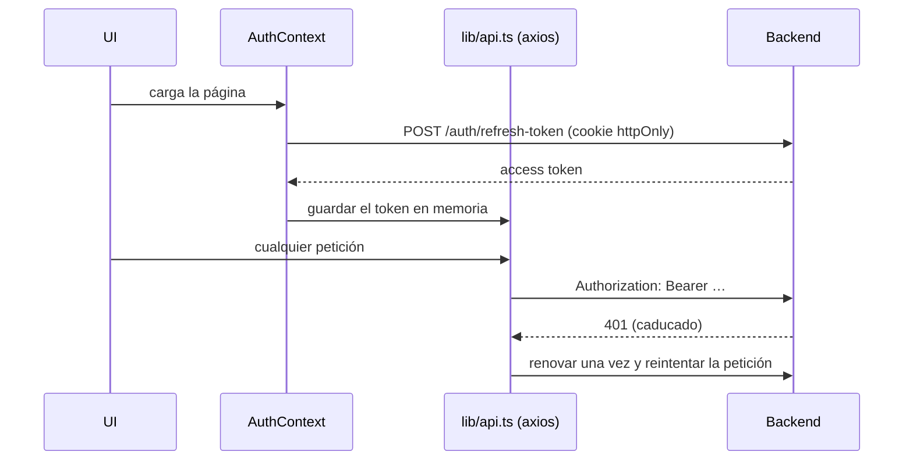
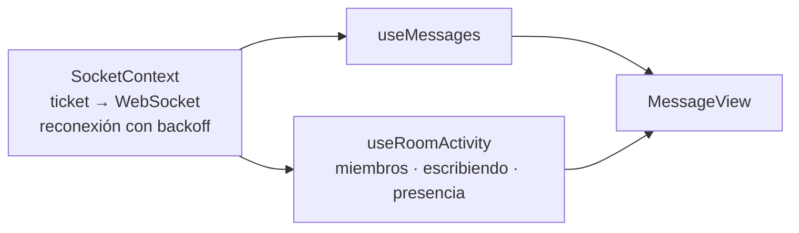
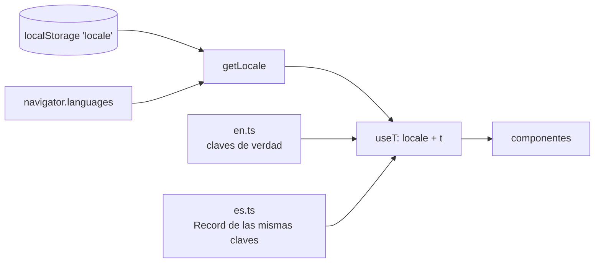

[English](../en/frontend.md) · **🌐 Español**

# Frontend

Next.js 16 (App Router), React 19, TypeScript, Tailwind CSS 3. Todo se ejecuta desde `frontend/` con Bun.

## 1. Estructura

```
src/
  app/              rutas: (auth) login, register, verify · (private) dashboard, profile
  components/       componentes de funcionalidad + ui/ primitivas (estilo shadcn, Radix + cva)
  contexts/         AuthContext, SocketContext
  hooks/            useMessages, useRoom, useRoomActivity, useUser, useAuth, useSocket
  services/         un *Service.ts por área de la API, todos mediante lib/api.ts
  lib/              api, tokenStorage, permissions, theme, backoff, typing, unread, i18n/
```

## 2. Flujo de sesión



El access token nunca se persiste (ver D6 en [Decisiones de diseño](decisions.md)). `PrivateRoute` protege el grupo `(private)`.

## 3. Tiempo real en la interfaz



- `SocketContext` abre una conexión por sesión y la expone a los hooks.
- `useMessages` aplica `new_message`, `update_message`, `delete_message`, `pin_message` y los eventos de reacciones, y conserva los mensajes **pendientes** (enviando, no enviado) para que el envío se sienta instantáneo y los fallos se puedan reintentar.
- Tras una reconexión ambos hooks recargan, porque los eventos enviados durante una caída se pierden.
- `MessageView` se monta con `key={roomId}`, así cada sala empieza con estado limpio.

## 4. Permisos en la interfaz

`lib/permissions.ts` replica la matriz del servidor para que la interfaz muestre solo los controles que un usuario podría usar (botón de fijar, selector de rol, panel de moderación). Es una comodidad: el servidor aplica todas las reglas.

## 5. Temas

Las paletas clara y oscura son variables CSS en `app/globals.css`. Un script en línea en `<head>` fija la clase `dark` antes del primer pintado, siguiendo al sistema operativo salvo que la persona haya elegido (se guarda en `localStorage`). **Usa siempre tokens semánticos de Tailwind** (`bg-background`, `text-muted-foreground`, `border-border`, `bg-primary`…), nunca colores fijos.

## 6. Internacionalización



| Pieza | Función |
|---|---|
| `lib/i18n/en.ts` | Fuente de verdad de todas las claves |
| `lib/i18n/es.ts` | `Record<MessageKey, string>` tipado: si falta una clave, falla la comprobación de tipos |
| `lib/i18n/index.ts` | `resolveLocale`, `translate` (interpolación `{param}`), `intlLocale` |
| `lib/i18n/useT.ts` | `useT()`, `setLocale`, `useHtmlLang` (store sobre `useSyncExternalStore`) |
| `LanguageToggle` | Selector EN / ES en el panel de usuario y en las pantallas de auth |

**Para añadir un texto:** añade la clave a `en.ts` y a `es.ts`, y usa `t('tu.clave', { param })`. Un test comprueba que ambos idiomas usan los mismos placeholders. Los esquemas que llevan mensajes (zod) son fábricas que reciben `t`, por ejemplo `makeRegisterSchema(t)`. Las fechas y horas usan `intlLocale(locale)`.

## 7. Controles de calidad

```bash
bunx tsc --noEmit && bun run lint && bun run test && bun run build
```
