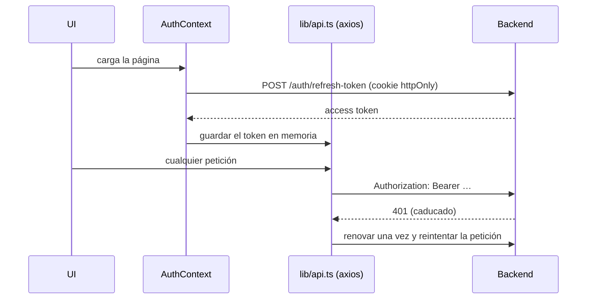
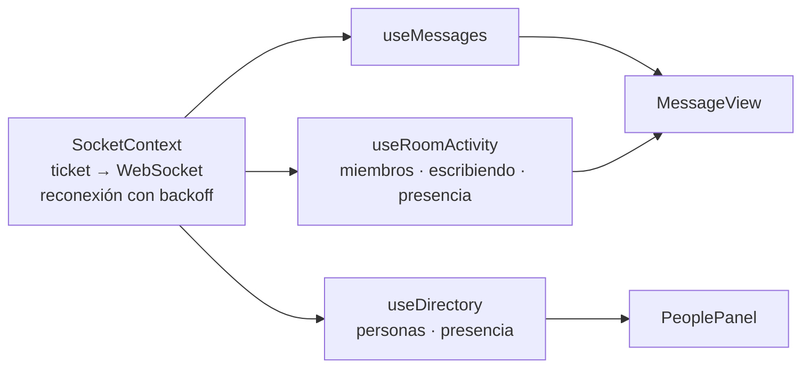
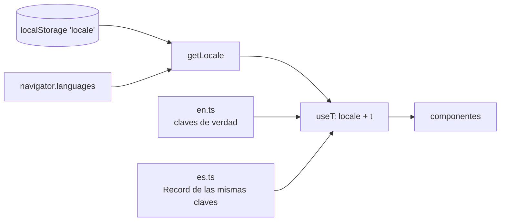

[English](../en/frontend.md) · **🌐 Español**

# Frontend

Next.js 16 (App Router), React 19, TypeScript, Tailwind CSS 3. Todo se ejecuta desde `frontend/` con pnpm.

## 1. Estructura

```
src/
  app/              rutas: (auth) login, register, verify · (private) dashboard, profile
  components/       componentes de funcionalidad + ui/ primitivas (estilo shadcn, Radix + cva)
  contexts/         AuthContext, SocketContext
  hooks/            useMessages, useRoom, useRoomActivity, useUser, useAuth, useSocket
  services/         un *Service.ts por área de la API, todos mediante lib/api.ts
  lib/              api, tokenStorage, permissions, theme, backoff, typing, unread, i18n/
```

## 2. Flujo de sesión



El access token nunca se persiste (ver D6 en [Decisiones de diseño](decisions.md)). `PrivateRoute` protege el grupo `(private)`.

Las sesiones sobreviven al cierre de la pestaña: el paso de restauración reintenta los fallos transitorios (`lib/sessionRestore.ts`) y se cierra la sesión solo cuando el servidor rechaza el refresh token (401/403), nunca por un error de red (D20). Las páginas `/forgot-password` y `/reset-password/[token]` implementan el restablecimiento de contraseña (D21); sus mensajes de error se traducen con `lib/resetErrors.ts`, así que nunca se muestra texto del servidor tal cual.

## 3. Tiempo real en la interfaz



- `SocketContext` abre una conexión por sesión y la expone a los hooks.
- `useMessages` aplica `new_message`, `update_message`, `delete_message`, `pin_message` y los eventos de reacciones, y conserva los mensajes **pendientes** (enviando, no enviado) para que el envío se sienta instantáneo y los fallos se puedan reintentar.
- `useDirectory` lista a todos con su estado de conexión para el `PeoplePanel`, siempre visible: aplica los eventos `presence`, recarga al reconectar y cada 60 s (quien no comparte sala contigo no recibe eventos en vivo, así que su punto puede tardar hasta un minuto). `useInvitations` consulta las invitaciones pendientes cada 15 s y al enfocar la ventana; `useDiscoverRooms` lista las salas a las que aún no te has unido.
- Tras una reconexión los hooks recargan, porque los eventos enviados durante una caída se pierden.
- `MessageView` se monta con `key={roomId}`, así cada sala empieza con estado limpio.

Los mensajes del socket se analizan una sola vez en `SocketContext` y se reparten por tipo con `lib/socketEvents.ts` (`useSocketEvent(type, handler)`); `useSocket()` sigue devolviendo el socket sin más. `usePolling` omite los ciclos con la pestaña oculta y vuelve a consultar al hacerse visible. El selector de emojis y sus datos se cargan bajo demanda, lo que quitó unos 510 KB de la primera carga del dashboard (de 1,28 MB a 0,77 MB sin comprimir). Las cabeceras de seguridad y la CSP están en `security-headers.mjs` (D25); los patrones de accesibilidad (anuncios en vivo, `ConfirmDialog`, `useFocusTrap`, títulos por ruta) están en D26. Los errores del cliente pasan por `lib/logError.ts`.

## 4. Permisos en la interfaz

`lib/permissions.ts` replica la matriz del servidor para que la interfaz muestre solo los controles que un usuario podría usar (botón de fijar, selector de rol, panel de moderación). Es una comodidad: el servidor aplica todas las reglas.

## 5. Diseño visual: "Foco"

La interfaz sigue la dirección **Foco**, elegida entre tres propuestas (Foco, Calidez, Redacción): un aspecto denso, rápido y orientado a equipos, con una escala neutra fría y **un** único acento índigo.

| Elemento | Regla |
|---|---|
| Salas | prefijo `#` en la fuente mono, candado para salas privadas, `@` para mensajes directos; la fila seleccionada usa el acento teñido (`bg-soft text-primary`) |
| No leídos | nombre en negrita más una píldora `bg-primary` |
| Mensajes | tarjetas con borde: avatar con iniciales, autor en negrita (púlsalo para abrir un mensaje directo), etiqueta de rol para propietario, admin y moderador, hora en mono; los tuyos van teñidos y alineados a la derecha; responder, fijar, denunciar y borrar aparecen al pasar el ratón (siempre visibles en pantallas táctiles) |
| Mensajes directos | la cabecera muestra el avatar, el estado de conexión y el @usuario de la otra persona; la barra lateral los lista con avatares; una conversación vacía muestra una nota de inicio |
| Reacciones | píldoras; las que añadiste usan `border-primary bg-soft`. El botón de añadir existe en todos los mensajes (al pasar el ratón cuando no tiene ninguna): una fila rápida de seis emojis más el selector completo (`EmojiPicker`, una capa flotante que nunca se recorta). En tus propios mensajes la fila rápida se abre hacia la izquierda |
| Compositor | botón de emoji que inserta en el borrador |
| Personas | `PeoplePanel`: una columna a la derecha, siempre visible en pantallas anchas (al final de la barra lateral en las pequeñas), con buscador, conectados primero y puntos de presencia; pulsa una persona para escribirle |
| Explorar | `DiscoverRooms` en la barra lateral: las salas públicas tienen botón Unirme; las privadas muestran un candado y "solo con invitación" |
| Invitaciones | las recibidas aparecen arriba de la barra lateral con Aceptar y Rechazar; propietarios y admins tienen un botón de invitar en la cabecera de la sala (`InviteUsers`) |
| Notificaciones | la campana de la cabecera de la barra lateral abre dos interruptores (guardados por navegador): un breve sonido sintetizado (una nota para salas, un par ascendente para mensajes directos) y las notificaciones del sistema, que piden permiso al navegador al activarlas. No se avisa de tus propios mensajes ni de la conversación que estás leyendo; las notificaciones del escritorio solo salen con la página en segundo plano, y pulsar una abre esa conversación. El título de la pestaña muestra el total sin leer, por ejemplo `(3) WebChat`. Las reglas de decisión están en `lib/alerts.ts` (con tests); el audio necesita un clic previo en la página, algo que una sesión normal siempre tiene |
| Onboarding | `OnboardingDialog`: una bienvenida de tres pasos (personas, salas, conversar) que se muestra una vez por persona; omitirla o terminarla guarda `onboarding:<userId>` en `localStorage`, y el botón de ayuda junto al selector de idioma la reabre. Los estados vacíos (sin salas, sin sala abierta) dicen qué hacer a continuación |
| Miembros de la sala | panel lateral (superpuesto en pantallas pequeñas) que se mantiene para roles, expulsar y vetar |
| Tipografía | Inter para el texto, JetBrains Mono (`font-mono`) para almohadillas, horas y contadores |
| Forma | radio base de 8 px, bordes finos, sin sombras salvo en capas superpuestas |

Tokens nuevos junto a los de shadcn: `soft` (tinte del acento) y `success` (punto de en línea). `Avatar` pinta las iniciales (`lib/initials.ts`).

### Temas

Las paletas clara y oscura son variables CSS en `app/globals.css`. Un script en línea en `<head>` fija la clase `dark` antes del primer pintado, siguiendo al sistema operativo salvo que la persona haya elegido (se guarda en `localStorage`). **Usa siempre tokens semánticos de Tailwind** (`bg-background`, `text-muted-foreground`, `border-border`, `bg-primary`…), nunca colores fijos.

## 6. Internacionalización



| Pieza | Función |
|---|---|
| `lib/i18n/en.ts` | Fuente de verdad de todas las claves |
| `lib/i18n/es.ts` | `Record<MessageKey, string>` tipado: si falta una clave, falla la comprobación de tipos |
| `lib/i18n/index.ts` | `resolveLocale`, `translate` (interpolación `{param}`), `intlLocale` |
| `lib/i18n/useT.ts` | `useT()`, `setLocale`, `useHtmlLang` (store sobre `useSyncExternalStore`) |
| `LanguageToggle` | Selector EN / ES en el panel de usuario y en las pantallas de auth |

**Para añadir un texto:** añade la clave a `en.ts` y a `es.ts`, y usa `t('tu.clave', { param })`. Un test comprueba que ambos idiomas usan los mismos placeholders. Los esquemas que llevan mensajes (zod) son fábricas que reciben `t`, por ejemplo `makeRegisterSchema(t)`. Las fechas y horas usan `intlLocale(locale)`.

## 7. Controles de calidad

```bash
pnpm exec tsc --noEmit && pnpm run lint && pnpm run test && pnpm run build
```
