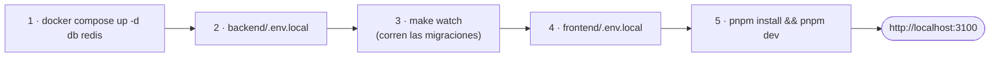

[English](../en/getting-started.md) · **🌐 Español**

# Primeros pasos

## 1. Requisitos

Go 1.26.10+, Node 22+ y pnpm (la versión está fijada en `package.json`; `corepack enable` o `npm i -g pnpm`), Docker con Compose, Make, `air` (recarga automática; `make watch` ofrece instalarlo) y `openssl`.

## 2. Puertos

| Servicio | Puerto en tu máquina | Contenedor |
|---|---|---|
| Frontend | 3100 | corre fuera de Docker |
| Backend | 8081 | `webchat-api` (solo en modo Docker) |
| PostgreSQL | 5433 | `webchat-db` |
| Redis | 6380 | `webchat-redis` |

Todo se publica solo en `127.0.0.1`. Los puertos evitan choques con otros proyectos locales; mantén `PORT`, `CORS_ALLOWED_ORIGINS` y `NEXT_PUBLIC_API_URL` coherentes con ellos.

## 3. Inicio rápido



```bash
# 1. Base de datos y caché
cd backend && docker compose up -d db redis

# 2. Backend: copia la plantilla, rellena cada <...> y luego
cp .env.example .env.local
make watch                         # http://localhost:8081

# 3. Frontend
cd ../frontend && cp .env.example .env.local
pnpm install && pnpm dev             # http://localhost:3100
```

Las contraseñas de la base de datos están definidas en `backend/docker-compose.yml`; cópialas a `.env.local`. **Nunca subas archivos de entorno reales**: solo las plantillas `.env.example` se versionan.

## 4. Variables de entorno (backend)

La plantilla `backend/.env.example` es la fuente de verdad. Las importantes:

| Variable | Obligatoria | Notas |
|---|---|---|
| `JWT_SECRET` | **Sí** | Al menos 32 caracteres (`openssl rand -hex 32`). El servidor no arranca sin ella |
| `DATABASE_URL` | Una de las dos | Tiene prioridad sobre `DB_*` |
| `DB_HOST`, `DB_PORT`, `DB_USER`, `DB_NAME`, `DB_PASSWORD` | Si no hay `DATABASE_URL` | El Postgres local está en el puerto 5433 |
| `REDIS_URL` | Una de las dos | Tiene prioridad sobre `REDIS_*` |
| `REDIS_HOST`, `REDIS_PORT`, `REDIS_PASS` | Si no hay `REDIS_URL` | El Redis local está en el puerto 6380 |
| `CORS_ALLOWED_ORIGINS` | En la práctica sí | Separada por comas; debe incluir el origen del frontend. También se usa para validar el `Origin` del WebSocket |
| `SMTP_HOST`, `SMTP_PORT`, `SMTP_FROM`, `SMTP_PASSWORD` | Solo para restablecer contraseña | Sin ellas «¿Olvidaste tu contraseña?» no envía nada (el error solo queda en el log). En local sirve un servidor SMTP de pruebas como Mailpit |
| `PORT` | No | Por defecto 8081 |
| `FRONTEND_URL` | No | Se usa en los enlaces de los correos |
| `APP_ENV` | No | `prod` / `production` activa el modo producción |

Frontend: una sola variable, `NEXT_PUBLIC_API_URL` (por defecto `http://localhost:8081/api/v1`).

Qué archivo carga cada cosa:

| Archivo | Lo usa |
|---|---|
| `backend/.env.local` | `make run`, `make watch` (backend en tu máquina) |
| `backend/.env.dev` | `make up-dev` (backend en Docker) |
| `backend/.env.prod` | `make up-prod` |
| `frontend/.env.local` | `pnpm dev` |

Dentro de Docker, los hosts y puertos son los internos (`DB_HOST=db`, `DB_PORT=5432`, `REDIS_HOST=redis`, `REDIS_PORT=6379`).

## 5. Comprueba que funciona

1. Abre `http://localhost:3100/register` y crea un usuario.
2. Inicia sesión, crea una sala y envía un mensaje.
3. En una ventana privada, crea un segundo usuario. Ambos aparecen en el panel **Personas** del otro; con el primero abre la sala, pulsa el botón de invitar de la cabecera e invita al segundo, que acepta desde el bloque **Invitaciones** al principio de la barra lateral.
4. Los mensajes deben llegar a ambas ventanas **sin recargar**: eso prueba que el WebSocket funciona.
5. Edita un mensaje, reacciona y fíjalo.

Comprobaciones útiles:

```bash
curl -s http://localhost:8081/health
curl -s http://localhost:8081/ready
docker exec -it webchat-db psql -U root -d webchat -c 'select * from schema_migrations'
```

## 6. Administración

Los roles globales solo se otorgan desde el servidor:

```bash
cd backend
make admin-grant EMAIL=tu@correo.com ROLE=admin     # admin | moderator
make admin-list
make admin-revoke EMAIL=tu@correo.com
```

## 7. Comandos del día a día

| Dónde | Comando | Qué hace |
|---|---|---|
| `backend/` | `make watch` / `make run` | ejecutar con / sin recarga automática |
| `backend/` | `make test` | `go test -v ./...` |
| `backend/` | `make up-dev` / `make down` | todo el stack en Docker / detenerlo |
| `backend/` | `docker compose down -v` | detener **y borrar todos los datos** |
| `frontend/` | `pnpm dev` · `pnpm run build` · `pnpm run lint` · `pnpm run test` | tareas del frontend |

## 8. Solución de problemas

| Síntoma | Causa probable | Solución |
|---|---|---|
| `JWT_SECRET must be set and at least 32 characters long` | Falta el secreto o es corto | Defínelo en `.env.local` |
| `DATABASE_URL is not set…` | `.env.local` no se cargó | Ejecuta `make watch` desde `backend/` |
| `unable to connect to database` | Contenedor apagado, puerto o contraseña erróneos | `docker compose ps`; usa el puerto **5433** en local |
| Error de Redis al arrancar | Puerto o contraseña erróneos | Usa el puerto **6380** en local |
| `bind: address already in use` | Otro proyecto usa el puerto | `ss -ltnp \| grep <puerto>` |
| El frontend carga pero hay errores de CORS | El origen no está en `CORS_ALLOWED_ORIGINS` | Añade `http://localhost:3100` y reinicia |
| Las peticiones van a `undefined/...` | Falta `frontend/.env.local` | Créalo y reinicia `pnpm dev` |
| `air: command not found` | `air` no está instalado | `go install github.com/air-verse/air@latest` |

La guía original con más detalle es [LEVANTAR.md](../LEVANTAR.md).
