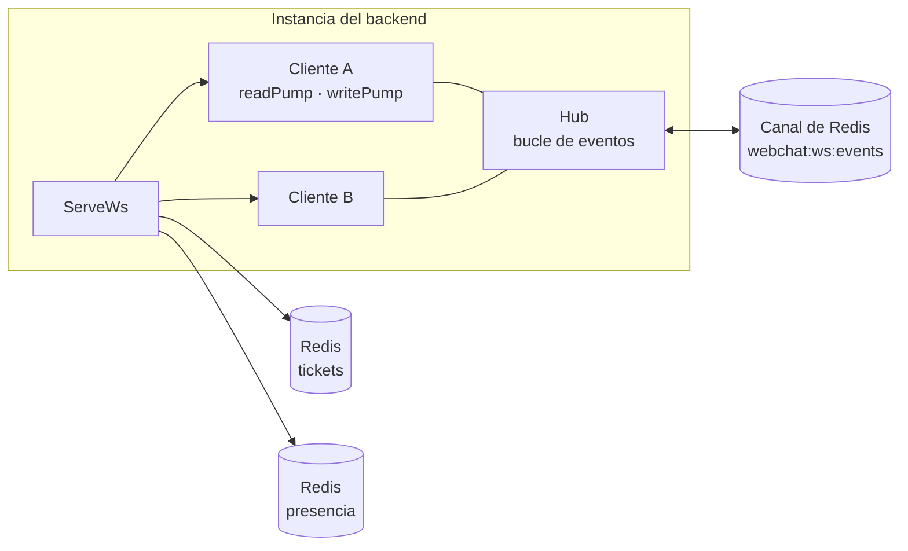
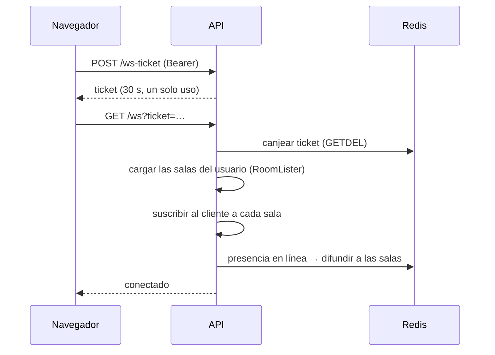
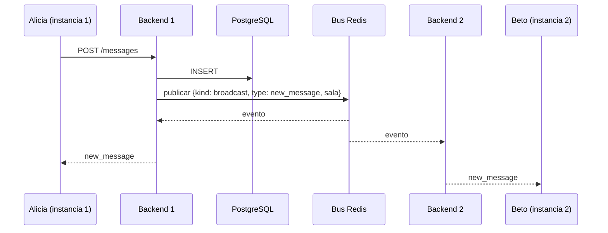
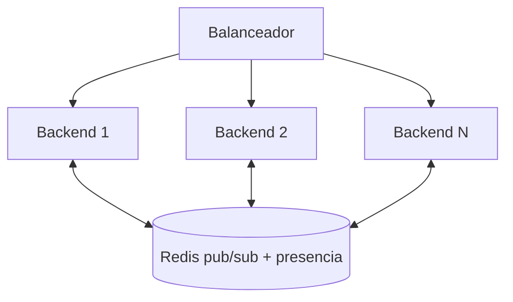

[English](../en/realtime.md) · **🌐 Español**

# Tiempo real

## 1. Componentes

- **Hub:** un único bucle de eventos que sabe qué clientes pertenecen a cada sala.
- **Cliente:** uno por conexión, con una goroutine de lectura y otra de escritura.
- **Bus:** publica cada evento en Redis para que todas las instancias lo entreguen a *sus* clientes.
- **Presencia:** un sorted set de Redis con `userID:clientID` puntuado por el último latido. Un usuario está en línea si al menos una conexión latió en los últimos 2 minutos.

## 2. Conexión

## 3. Envío de un mensaje

Quien envía también recibe el evento, y así se confirma el mensaje optimista.

## 4. Eventos

Servidor → cliente, con `type` y `payload`:

| Tipo | Se envía cuando |
|---|---|
| `new_message` | se crea un mensaje |
| `update_message` | se edita un mensaje |
| `delete_message` | se borra un mensaje (el autor o un moderador) |
| `pin_message` | se fija o desfija un mensaje |
| `reaction_added`, `reaction_removed` | cambian las reacciones |
| `role_changed`, `member_removed` | cambia el rol de un miembro o se le expulsa |
| `typing` | un miembro está escribiendo (efímero, nunca se guarda) |
| `presence` | un miembro se conecta o desconecta |

Cliente → servidor: solo `{ "type": "typing", "room_id": … }`, aceptado de miembros de la sala y con límite de frecuencia.

Entre instancias el bus transporta cuatro clases: `broadcast`, `subscribe`, `unsubscribe` y `disconnect`. Las tres últimas aplican un cambio de membresía (entrar a una sala, ser expulsado, borrar la cuenta) en la instancia que tenga la conexión del usuario.

## 5. Modelo de fiabilidad

- **Entrega como máximo una vez.** Si un cliente está desconectado, pierde eventos. Es un compromiso deliberado frente al coste de un registro de eventos (ver D8 en [Decisiones de diseño](decisions.md)).
- **Recuperación en el cliente.** `SocketContext` reconecta con backoff exponencial (`lib/backoff.ts`) y pide un ticket nuevo cada vez. Tras reconectar, `useMessages` y `useRoomActivity` recargan los últimos mensajes y miembros, de modo que la pantalla converge al estado real.
- **Fuente de verdad.** La base de datos. Los eventos son avisos que hacen la interfaz rápida; una recarga siempre la repara.

## 6. Escalar horizontalmente

No se necesitan sesiones pegajosas: un cliente puede conectarse a cualquier instancia y seguir viendo los eventos que se originan en las demás. La planificación de capacidad y las pruebas de carga (k6) están en el roadmap.
