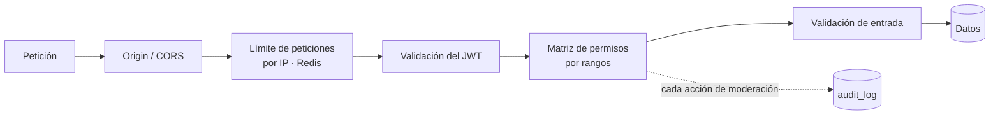
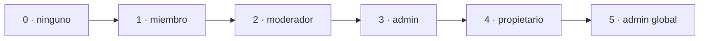

[English](../en/security.md) · **🌐 Español**

# Seguridad

La seguridad va por capas: ningún control se considera suficiente por sí solo.

## 1. Autenticación

| Elemento | Comportamiento |
|---|---|
| Contraseñas | Hashes bcrypt en su propia tabla (`passwords`), nunca devueltos por la API |
| Política de contraseñas | 8–72 caracteres (72 es el límite de bcrypt); rechaza unas 2000 contraseñas muy comunes (lista embebida) y las que contienen el usuario o la parte local del email |
| Access token | JWT de 1 hora, enviado como `Authorization: Bearer …` |
| Refresh token | JWT de 7 días, **un solo uso** (sigue valiendo 30 s más para que pestañas simultáneas no choquen); su id se guarda en Redis; cookie httpOnly, `SameSite=Strict`, limitada a `/api/v1/auth` |
| Persistencia de sesión | cada renovación emite otros 7 días, así la sesión termina tras una semana **sin uso**; el navegador cierra sesión solo si el servidor rechaza el token, nunca por un error de red (D20) |
| Tipos de token y sesiones vivas | cada JWT lleva `typ` (`access`/`refresh`/`verify`) y los consumidores exigen el suyo; solo HS256. Un guardián de sesión rechaza en cada petición los tokens emitidos antes de una revocación y los de usuarios desactivados (D23). Desactivar exige la contraseña y termina sesiones y sockets al instante |
| Identidad | los nombres de usuario son `[A-Za-z0-9_.-]` (3–30); email y usuario son únicos sin distinguir mayúsculas; login y restablecimiento tardan lo mismo con cuentas desconocidas; los nombres de usuario reservados (`admin`, `support`, `system`...) no se pueden registrar; los nombres se recortan, se normalizan a NFC y rechazan caracteres de control, bidi y de ancho cero; bcrypt con coste 12, y como mucho la mitad de las CPU calculan hashes a la vez (el resto espera hasta 5 s) para que una ráfaga de logins no deje sin recursos a la API |
| Limitación de logins | los fallos de login frenan a la **cuenta**, no solo a la IP: tras 5 fallos desde una misma dirección, o 20 desde cualquiera, para el mismo usuario o email, los intentos reciben `429` + `Retry-After` con una espera que se duplica hasta 5 minutos. Nunca es un bloqueo permanente (un atacante lo usaría para dejar fuera a la gente) y un acierto lo borra; las cuentas inexistentes también cuentan. Los contadores están en Redis y la comprobación deja pasar los logins si Redis no está disponible |
| Límites | cuerpos ≤ 1 MiB, timeouts del servidor, límites de tasa por IP en cada ruta que modifica estado, `TRUSTED_PROXIES` tras un balanceador (D27). Editar mensajes exige ser miembro y limita el contenido a 4000 caracteres; las reacciones deben ser un único emoji (sin texto libre) y tienen tope (10 distintas por persona, 30 por mensaje) |
| Navegador | cabeceras de seguridad y CSP en la aplicación web (D25); los errores del cliente se registran sin cuerpos de petición ni credenciales |
| Restablecer contraseña | `POST /auth/forgot-password` responde siempre igual, así que nunca revela quién tiene cuenta. El enlace del correo lleva un token aleatorio de 256 bits válido 30 minutos y de **un solo uso**; solo se guarda su hash SHA-256. Como máximo un correo por dirección y minuto, además de un límite por cliente. `POST /auth/reset-password` aplica la política de contraseñas del registro (una contraseña rechazada deja el enlace válido) y después **cierra todas las sesiones**: los refresh tokens emitidos antes se rechazan (los access tokens caducan en menos de una hora) (D21) |
| Cierre de sesión | `POST /auth/logout` revoca el id de refresh y borra la cookie |
| Secreto | el servidor se niega a arrancar sin un `JWT_SECRET` de al menos 32 caracteres que no sea un texto de ejemplo (`change-me`, `your-secret`...), ni un patrón repetido, y que use al menos 8 caracteres distintos. Genéralo con `openssl rand -base64 48` |
| Errores de login | el formulario muestra un único mensaje genérico, así no revela si un email existe |

El razonamiento de cada elección está en [Decisiones de diseño](decisions.md) (D5–D7, D20, D21).

## 2. WebSocket

- El JWT nunca aparece en una URL: `POST /ws-ticket` devuelve un ticket de 30 segundos y un solo uso guardado en Redis.
- La cabecera `Origin` debe coincidir con `CORS_ALLOWED_ORIGINS`.
- Un cliente solo puede anunciar `typing` en una sala a la que está suscrito, y no con más frecuencia que un intervalo fijo.
- Al expulsar o vetar a un miembro, su conexión se desuscribe de la sala (o se desconecta al borrar la cuenta).

## 3. Autorización: la matriz de permisos

Todo vive en `internal/shared/permissions`. Los roles de sala y los globales se reducen a un único **rango**:

Un **moderador** global actúa como moderador en todas las salas; un **admin** global supera a todos los propietarios de sala.

| Acción | Rango mínimo |
|---|---|
| Leer una sala, enviar mensajes | 1 · miembro |
| Borrar mensajes ajenos, resolver denuncias | 2 · moderador |
| Expulsar o vetar a un usuario | 2 · moderador **y estrictamente por encima del objetivo** |
| Fijar mensajes, crear invitaciones (códigos o personales) | 3 · admin |
| Cambiar roles | 3 · admin, solo sobre miembros por debajo: un admin puede crear moderadores, solo los propietarios (o admins globales) pueden crear admins; el rol de propietario nunca se asigna |
| Leer el registro de auditoría | 3 · admin |

Como las reglas comparan rangos, un moderador nunca puede actuar sobre otro moderador, un admin o el propietario.

Los vetos siguen la misma regla: un veto recuerda el rango de quien lo impuso, y levantarlo o reemplazarlo (por ejemplo acortar uno permanente) exige ser quien lo impuso o **tener un rango superior al suyo**. Un moderador no puede deshacer el veto de un admin ni del propietario; un admin sí puede deshacer el de un moderador. A los vetos anteriores a esta regla se les asignó el rango actual de quien los impuso (0 si ya no existe, así que cualquier moderador puede levantarlos).

## 4. Protección contra abuso

Los límites son por IP de cliente y se guardan en Redis (`/api/v1`):

| Ruta | Límite |
|---|---|
| `POST /auth/login` | 10 por minuto |
| `POST /auth/register` | 20 cada 10 minutos |
| `POST /auth/refresh-token` | 30 por minuto |
| `POST /auth/send-verify-email/:user_id` | 5 cada 10 minutos |
| `POST /ws-ticket` | 30 por minuto |
| `POST /messages` | 120 por minuto |
| `GET /messages/search` | 60 por minuto |
| `GET /users/export`, `DELETE /users/me` | 5 por hora cada una |

Al superarlos la API responde `429` con la cabecera `Retry-After`. Si Redis no está disponible, el limitador deja pasar el tráfico y registra el fallo. Detrás de un proxy inverso hay que configurar los proxies de confianza para que la IP del cliente no se pueda falsificar.

## 5. Moderación y auditoría

- Los miembros denuncian mensajes (una denuncia por persona, nunca del propio). Los moderadores revisan la cola y pueden borrar el mensaje, marcar la denuncia como resuelta o ignorarla.
- Los vetos son por sala, temporales o permanentes, e impiden volver a entrar por id o por invitación. Levantar o reemplazar uno exige tener un rango superior al de quien lo impuso (ver la matriz anterior).
- Las invitaciones personales caducan a los 30 días, los admins pueden listar y cancelar las pendientes de una sala, y aceptar exige que quien la envió siga siendo admin o propietario de la sala (igual que los códigos de invitación).
- Toda acción sensible se escribe en `audit_log` con quien actúa, el objetivo, la sala y los detalles. Solo los admins lo leen.

## 6. Privacidad

- **Directorio y descubrimiento:** cualquier usuario con sesión puede listar a otros usuarios activos (nombre, usuario, estado de conexión) y el nombre, tema y número de miembros de cada sala. Leer o escribir en una sala sigue exigiendo ser miembro, así que una sala privada es visible pero está cerrada. Las invitaciones personales solo las puede responder el usuario invitado (cualquier otro recibe "no encontrada") y al aceptar se vuelven a comprobar los vetos.
- `GET /users/export` descarga un JSON con el perfil, las salas, los mensajes y las reacciones del usuario.
- `DELETE /users/me` (confirmado con la contraseña) borra la cuenta: ver D13 en [Decisiones de diseño](decisions.md).

## 7. Límites conocidos

El directorio expone nombres y usuarios a cualquier persona con sesión: adecuado para un servidor de equipo, pero un despliegue público necesitaría un ajuste de visibilidad (ver D18 en [Decisiones de diseño](decisions.md)).

La verificación de email está implementada pero **pausada**, y `POST /auth/send-verify-email/:user_id` sigue siendo público (registrado como H-008 en el registro de hallazgos). Docker Compose todavía lleva contraseñas de base de datos en el archivo (H-051).

## 8. Cómo reportar una vulnerabilidad

Por favor no abras una incidencia pública. Contacta de forma privada con los mantenedores e incluye los pasos para reproducirla.
